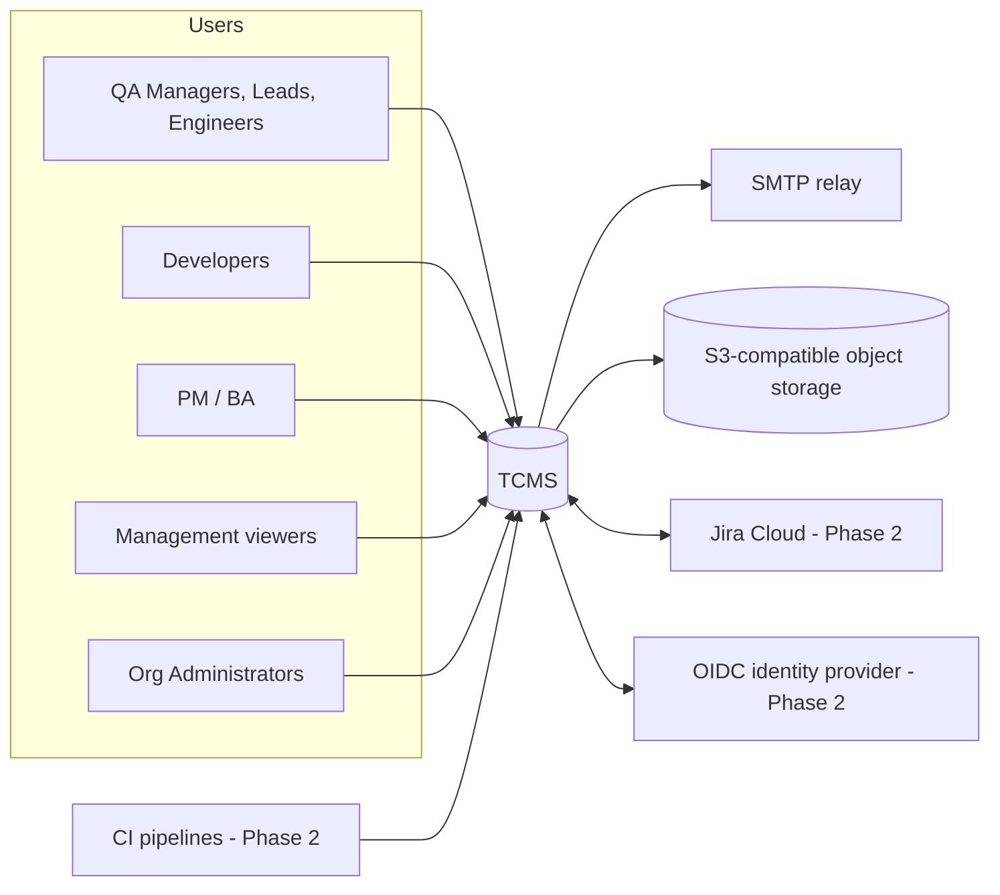
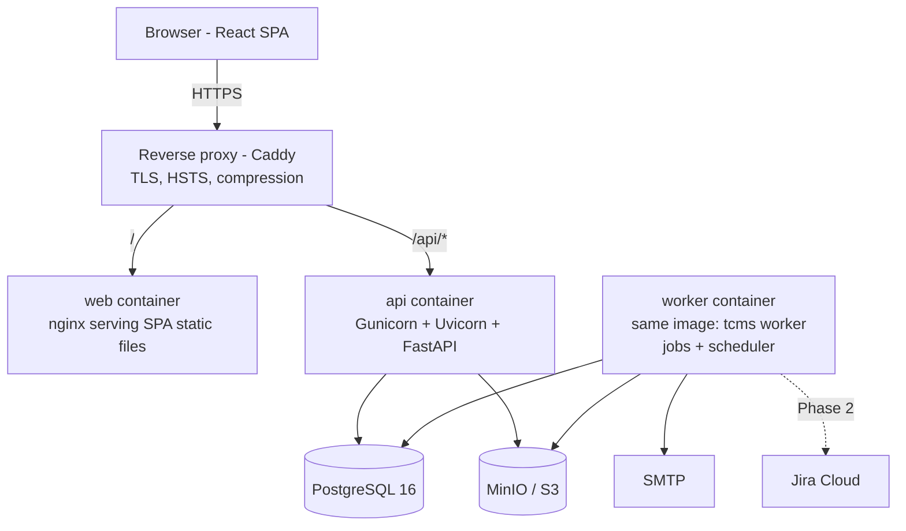
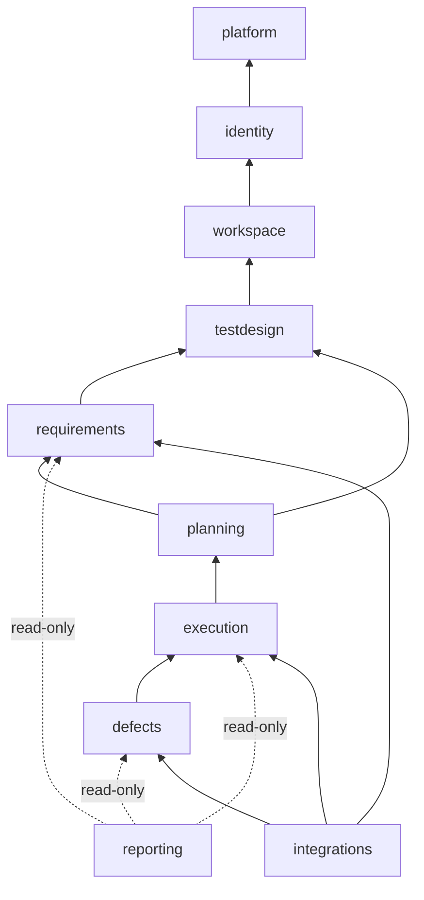
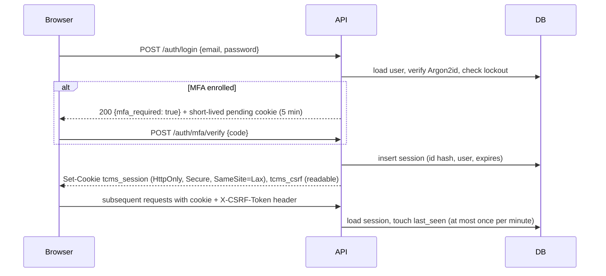
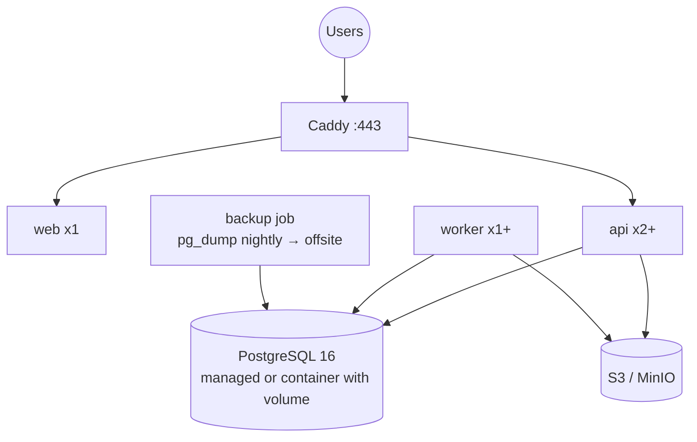

# 03 — High-Level Design (Technical Architecture)

| Field | Value |
| --- | --- |
| Version | 1.0 · 2026-11-03 |
| Depends on | [01 PRD](01-PRD.md), [02 Functional Spec](02-Functional-Specification.md) |
| Detailed by | [04 LLD](04-LLD.md), [05 Database](05-Database-Design.md), [06 API](06-API-Specification.md) |
| Decisions | [11 Decision Log](11-Decision-Log.md) (ADR-xxx) |

Diagrams are Mermaid so they stay editable in the repository.

---

## 1. Architecture drivers

| Driver | Consequence |
| --- | --- |
| Two maintainers, code generated by Claude Code | Modular monolith, one backend image, conventional patterns, strong typing, generated API client (ADR-001, ADR-004) |
| Immutable history, audit evidence (ISO 27001/SOC 2) | Append-only tables guarded in the database; audit in the same transaction (ADR-007, ADR-008) |
| Self-hosted, cloud-ready | Docker images; S3-compatible storage; all config via environment (ADR-010) |
| Modest scale (10× headroom: 100k cases/project, 500k results) | PostgreSQL only; no search engine; no cache tier; background jobs in PostgreSQL (ADR-005, ADR-006) |
| Integrations later without core changes | Connector interface, external links table, job/outbox mechanism present from MVP (ADR-011) |
| Correct metrics | Metrics computed in SQL from base tables + daily snapshots for trends; one metrics module owns definitions (ADR-013) |

## 2. Technology stack (pinned major versions)

| Layer | Choice | Notes |
| --- | --- | --- |
| Backend language | Python 3.12 | |
| Web framework | FastAPI 0.16x + Uvicorn (served by Gunicorn with Uvicorn workers in prod) | Sync route handlers (`def`) executed in thread pool (ADR-004) |
| ORM / SQL | SQLAlchemy 2.1 (sync, typed `Mapped[]`; 2.0-style API), psycopg 3 | Raw SQL (via `text()`) allowed for reporting queries |
| Migrations | Alembic | Forward-only (ADR-014) |
| Validation | Pydantic v2 | Request/response schemas, settings |
| Auth crypto | argon2-cffi (Argon2id), pyotp (TOTP), cryptography (AES-GCM) | |
| Background jobs | In-house PostgreSQL job queue (`jobs` table, `FOR UPDATE SKIP LOCKED`) | ADR-005; no Redis in MVP |
| Object storage | boto3 against S3 API; MinIO in development (image `cgr.dev/chainguard/minio`: Docker Hub no longer publishes `minio/minio`) | |
| Excel/CSV | openpyxl, Python `csv` | |
| Markdown | Server: markdown-it-py (for exports/PDF P2); client renders | |
| Database | PostgreSQL 16 with `pg_trgm`, `unaccent` | |
| Frontend | React 18, TypeScript 5 (strict), Vite 8 | |
| Routing / data | TanStack Router, TanStack Query | |
| Tables | TanStack Table + virtualized rows (TanStack Virtual) | |
| Forms | react-hook-form + zod | |
| UI kit | Tailwind CSS 4 + shadcn/ui (Radix primitives), lucide icons | Components copied into repo, owned by us |
| Charts | Recharts | |
| Markdown editor | Plain textarea with toolbar + preview (react-markdown + rehype-sanitize) | No WYSIWYG in MVP (ADR-015) |
| API client | openapi-typescript + openapi-fetch generated from `/openapi.json` | NFR-MNT-03 |
| Tests | pytest, pytest-xdist, testcontainers (PostgreSQL), Schemathesis; Vitest + Testing Library; Playwright; k6; OWASP ZAP | See [08 QA](08-QA-Strategy.md) |
| Lint/format | ruff, mypy; ESLint, Prettier; import-linter (module boundaries) | |
| Containers | Docker, Docker Compose v2 | |
| Reverse proxy | Caddy (automatic TLS) or existing corporate proxy | |

## 3. System context



## 4. Container view



- **One backend image**, two process types: `api` (HTTP) and `worker` (`tcms worker` runs jobs and the scheduler loop). Both share code, config and migrations.
- **web** is a static nginx image with the built SPA; the SPA calls `/api/v1` on the same origin (no CORS in production).
- **Same-origin** deployment keeps cookie auth simple and CSRF-safe.
- Migrations run as a one-shot container (`tcms migrate`) before `api` starts (compose `depends_on: condition: service_completed_successfully`).

## 5. Backend: modular monolith

### 5.1 Domains (modules)

| Module (package) | Owns tables | Depends on (services only) |
| --- | --- | --- |
| `identity` | users, user_mfa, mfa_recovery_codes, sessions, api_tokens, password_reset_tokens, login_attempts, invitations, roles, role_permissions, organization_members, project_members | `platform` |
| `workspace` | organizations, projects, environments, releases, release_decisions, key_sequences | `identity`, `platform` |
| `testdesign` | folders, test_cases, test_case_versions, test_case_steps, tags, test_case_tags, test_case_links, automation_keys | `workspace`, `identity`, `platform` |
| `planning` | test_plans, test_plan_cases, test_plan_requirements, test_plan_environments | `testdesign`, `requirements`, `workspace`, `platform` |
| `execution` | test_cycles, test_runs, test_results, test_step_results | `testdesign`, `planning`, `workspace`, `platform` |
| `defects` | defects, defect_links, defect_status_history, defect_watchers | `execution`, `testdesign`, `workspace`, `platform` |
| `requirements` | requirements, requirement_case_links | `testdesign`, `workspace`, `platform` |
| `reporting` | metric_snapshots, (read access to all via SQL views) | read-only queries over all; `platform` |
| `integrations` | integration_connections, external_links, automation_imports (P2) | calls other modules' services |
| `platform` | audit_events, jobs, attachments, attachment_links, comments, notifications, saved_views, data_transfers, idempotency_keys | none (leaf) |

Cross-cutting packages (not domains): `core` (config, db session, security primitives, errors, pagination, permissions registry), `api` (routers), `cli`.



### 5.2 Boundary rules (enforced by import-linter in CI)

1. A module's **repositories and models are private**. Other modules call its `service` functions or read its public `queries` (read DTOs).
2. Dependencies point downward only (graph above); no cycles. Upward needs (e.g. execution needs to know a defect is linked) use **in-process domain events** (handlers run in the producing transaction for consistency rules, or enqueue jobs for side effects; §5.4) or a read-only query interface.
3. `reporting` may execute read-only SQL over any table (it owns metric definitions, ADR-013) but never writes outside its own tables.
4. `integrations` never writes other modules' tables directly; it calls their services as a system actor.
5. Every write path goes through a service function that: checks permission, validates, writes, records audit, enqueues jobs/events — inside one transaction (Unit of Work).

### 5.3 Layers inside a module

```
api router (HTTP, schemas)  →  service (use cases, rules, permissions, audit)
                            →  repository (SQLAlchemy queries, tenant-scoped)
                            →  models (SQLAlchemy ORM)
```

Details and code templates: [04 LLD §3](04-LLD.md).

### 5.4 In-process domain events

Lightweight synchronous dispatcher; handlers run **in the same transaction** (for consistency rules) or are converted into jobs (for side effects like email). Examples:

| Event | Producer | Handlers |
| --- | --- | --- |
| `DefectTransitioned(to=ready_for_retest)` | defects | execution: set `needs_retest`; platform: notifications job |
| `ResultFinalized` | execution | defects: none in MVP; reporting: mark snapshot dirty; integrations (P2): none |
| `TestCaseVersionCreated` | testdesign | execution: none (runs pinned); notifications if in review |
| `MembershipChanged` | identity | platform: session permission cache bust |

## 6. Data architecture

### 6.1 Multi-tenancy (ADR-003)

- Shared database, shared schema. Every tenant-owned table has `organization_id`; project-owned tables also have `project_id`.
- Repositories derive from a scoped base that **requires** an `AccessContext` (org ID, project ID, user, permissions) and adds tenant predicates to every query. Unscoped queries are only available in `reporting` (still filtered by org) and maintenance CLI.
- Composite foreign keys or check triggers ensure child rows belong to the same project as parents for critical relations (e.g., a run's case is in the cycle's project) — see [05 Database §4](05-Database-Design.md).
- PostgreSQL Row-Level Security is **not** used in MVP (ADR-003): it complicates connection pooling and debugging for a small team; cross-tenant tests compensate.

### 6.2 Immutability enforcement (ADR-007)

| Data | Mechanism |
| --- | --- |
| `test_case_versions`, `test_case_steps` | Trigger blocks UPDATE/DELETE; the only delete path is the hard delete of a never-run case through `purge_test_case()`, a SECURITY DEFINER function owned by `tcms_owner` that checks BR-14 |
| `test_results` (state = final), `test_step_results` of final results | Trigger blocks UPDATE/DELETE when parent result is final |
| `audit_events`, `defect_status_history`, `release_decisions` | App role has INSERT/SELECT only; trigger also blocks |

### 6.3 IDs and keys

UUIDv7 primary keys generated in the application (time-ordered → good index locality). Human keys allocated from `key_sequences` with `UPDATE … RETURNING` in the same transaction (gap-free per committed transaction is not required; never reused is).

### 6.4 Search

`tsvector` generated columns (`search_vector`) on test_cases (title + description of latest version), requirements, defects; GIN indexes. `pg_trgm` GIN indexes on titles/names for fuzzy prefix. Key lookups by exact index.

### 6.5 Reporting data

- Live metrics: SQL aggregates over `test_runs` (current status is denormalized on the run — maintained by the execution service on finalize) with indexes on `(cycle_id, status)`.
- Trends: `metric_snapshots` — one row per project × release × day (and per cycle × day) with counters, written nightly at 00:15 UTC and on demand ("refresh"); today's values computed live.
- No separate warehouse.

### 6.6 Migrations

Alembic, forward-only; every migration has an upgrade and a tested data path; destructive changes use expand → migrate → contract across two releases. Details: [05 Database §8](05-Database-Design.md).

## 7. API architecture

- REST over JSON, base path `/api/v1`. Breaking changes → `/api/v2` alongside v1 for ≥ 6 months.
- OpenAPI 3.1 generated by FastAPI; published at `/api/v1/openapi.json`; the frontend client is generated from it in CI and the build fails on drift.
- Errors: RFC 9457 `application/problem+json` with a stable `code` (catalog in [06 API §3](06-API-Specification.md)).
- Resource style: nested for creation under a project (`POST /projects/{pid}/test-cases`), flat by ID for item operations (`GET /test-cases/{id}`) — the ID determines the project; access is checked against it.
- Commands that are not CRUD use action sub-resources: `POST /test-cases/{id}/approve`, `POST /results/{id}/finalize`, `POST /defects/{id}/transitions`.
- Optimistic concurrency via `row_version` in body (and `ETag`/`If-Match` supported).
- Idempotency: `Idempotency-Key` header supported on POST endpoints that create (stored 24 h in `idempotency_keys`) — required for automation uploads (P2), optional elsewhere.

## 8. Integration architecture

### 8.1 Connector framework (MVP skeleton, P2 implementation)

```mermaid
flowchart LR
  subgraph Core
    svc[Domain services\n(defects, requirements, testdesign)]
    xl[(external_links)]
    jobs[(jobs / outbox)]
  end
  subgraph integrations
    reg[Connector registry]
    jira[JiraCloudConnector]
    other[Future: AzureBoards, GitLab]
  end
  svc -- enqueue outbound job --> jobs
  jobs -- worker --> reg
  reg --> jira
  reg --> other
  jira -- calls service as system actor --> svc
  jira --> xl
```

Connector interface (Python protocol; full signature in [04 LLD §9](04-LLD.md)):

- `test_connection()`, `list_projects()`, `get_issue(key)`, `search_issues(query, cursor)`, `create_issue(payload)`, `map_status(external_status) -> category`, `parse_webhook(request)`.

Key tables:

- `integration_connections` — org-level connection, type, config JSON, encrypted credentials, status, last error.
- `external_links` — `(entity_type, entity_id) ↔ (connection_id, external_key, external_id, url)`, `owner` (`tcms`|`external`), `mirror` JSON (cached fields), `synced_at`, `sync_error`.

### 8.2 Synchronization rules

- **Outbound** (TCMS → Jira): written as a job in the same transaction as the domain change (transactional outbox). Worker executes; on failure retries with backoff (1 min, 5, 15, 60, 240) then dead-letters; record shows "sync failed — retry".
- **Inbound** (Jira → TCMS): webhook endpoint (verifies signature/secret) enqueues a fetch job; polling job as a safety net. Inbound only updates **mirror fields** on records owned by Jira; never overwrites TCMS-owned fields.
- No field is writable on both sides (no bidirectional sync) — ADR-011.

### 8.3 Source of truth (BR-33)

| Entity / field | Owner | Other side |
| --- | --- | --- |
| Test cases, versions, steps | TCMS | Jira shows link only |
| Plans, cycles, runs, results | TCMS | Jira may show a summary panel (P3) |
| Requirements authored in TCMS | TCMS | — |
| Requirements imported from Jira | Jira (title, description, status, priority, acceptance criteria) | TCMS owns links to cases and coverage |
| Defects created in TCMS (internal) | TCMS | — |
| Defects created in Jira from TCMS | Jira (status, assignee, resolution, priority after creation) | TCMS owns links to results/cases and retest flags; initial content sent once at creation |
| Users | TCMS (P2: IdP via OIDC) | — |

### 8.4 Automation results ingestion (P2)

```mermaid
sequenceDiagram
  participant CI
  participant API as api /automation/results
  participant J as jobs
  participant W as worker
  participant EX as execution service
  CI->>API: POST JUnit XML (token, project, release, env, build)
  API->>API: auth token (automation:submit), size ≤ 50 MB, store file in S3
  API->>J: enqueue automation.import (idempotency key)
  API-->>CI: 202 {import_id, status_url}
  W->>J: claim job
  W->>W: parse XML (defusedxml), map keys → cases
  W->>EX: create/reuse automation cycle, runs; record finalized attempts (source=automation)
  W->>J: mark done, write import report
```

## 9. Authentication and authorization

### 9.1 Browser sessions (ADR-006)



- Server-side sessions in PostgreSQL (`sessions` table; token stored as SHA-256 hash). Revocation is immediate.
- CSRF: double-submit token (`tcms_csrf` cookie value echoed in `X-CSRF-Token`) required for non-GET requests with cookie auth.
- API tokens: `Authorization: Bearer tcms_…`; CSRF not required; cookies ignored when a bearer token is present.
- Phase 2 OIDC: authorization-code + PKCE against configured IdP; on callback, find user by verified email (or `sub` link); session issued the same way; org policy "SSO required" disables password login except for a break-glass admin.

### 9.2 Authorization

1. Resolve **principal** (user or token) and **organization**.
2. For project-scoped resources, resolve the resource's `project_id` (from path or by loading the entity).
3. Compute effective permissions: org admin → all; else union of permissions of the user's project role (cached per request; per-session cache invalidated by `MembershipChanged`). Token scope intersects.
4. Service function declares the required permission; `require(ctx, "cycle.manage")` raises `403 permission_denied`.
5. Resource-level rules (e.g., "only the draft executor", "dev transitions only if assignee") are checked in services.
6. Non-members get `404` for project resources (avoid leaking existence).

## 10. Background processing (ADR-005)

- `jobs` table: `id, organization_id, type, payload jsonb, status (queued|running|succeeded|failed|dead), run_at, attempts, max_attempts, last_error, locked_by, locked_at, dedupe_key, created_at, finished_at`.
- Worker loop: `SELECT … WHERE status='queued' AND run_at <= now() ORDER BY run_at FOR UPDATE SKIP LOCKED LIMIT 1`, mark running, execute handler in its own transaction, mark result: `succeeded`; retryable error → back to `queued` with backoff; `dead` when `max_attempts` is reached; `failed` for a permanent error raised by the handler. Stale `running` jobs (locked > 15 min) are re-queued.
- Concurrency: N worker threads per container (default 4); scale containers for more.
- Scheduler: same process; cron table in code; inserts jobs with `dedupe_key` (e.g. `snapshot:2026-11-03`) to avoid duplicates across workers.

| Job type | Trigger |
| --- | --- |
| `email.send` | Invitations, resets, notifications |
| `notifications.digest` | Daily 07:00 per user time zone (hourly scan) |
| `import.dry_run`, `import.commit` | User import |
| `export.generate` | Large exports |
| `cycle.create_runs` | Cycles > 500 runs |
| `bulk.apply` | Bulk ops > 200 items |
| `metrics.snapshot` | Nightly 00:15 UTC; on demand |
| `attachments.gc` | Daily: delete objects of discarded drafts and orphan uploads > 24 h |
| `sessions.cleanup` | Hourly |
| `audit.retention` | Monthly |
| `jira.*`, `automation.import` | Phase 2 |

## 11. File storage

- Upload: `POST /attachments` (multipart) streamed through the API to S3 (`tcms-attachments` bucket, key `org/{org_id}/{yyyy}/{mm}/{uuid}`), max size enforced while streaming, MIME sniffed from first bytes (python-magic) against allow-list, SHA-256 stored.
- Download: `GET /attachments/{id}/content` checks permission on the owning record, then streams from S3 (or 302 to a 60-second presigned URL when `ATTACHMENTS_PRESIGNED_DOWNLOADS=true` for large files).
- Images get `Content-Disposition: inline` with `Content-Security-Policy: sandbox`; everything else `attachment`.
- Server-side encryption enabled on the bucket (SSE-S3 or MinIO KMS). Optional ClamAV scan hook (P2) before the attachment becomes downloadable.

## 12. Deployment architecture

### 12.1 Environments

| Environment | Purpose | Data |
| --- | --- | --- |
| Local | Development (`docker compose up`) | Seed data (SPARK demo project) |
| CI | Automated tests (ephemeral containers) | Fixtures |
| Staging | Pre-production validation, UAT | Anonymized copy or seed |
| Production | Live | Real |

### 12.2 Production topology (single host, scalable)



- Images: `tcms-backend:<version>` (api/worker/migrate/cli), `tcms-web:<version>`. Built in CI, tagged by git SHA and semver.
- Configuration: environment variables (§16); secrets via Docker secrets or the host's secret manager.
- Upgrade: pull images → run `migrate` → rolling restart api/worker (migrations backward-compatible per expand/contract).
- Backups: nightly `pg_dump -Fc` to off-host storage, 30 daily + 12 monthly; object storage versioning enabled; quarterly restore drill (NFR-REL-03).
- Scaling path: add api replicas behind Caddy; add worker replicas; move PostgreSQL to a managed service; S3 for storage.

### 12.3 Local development

`docker compose up` starts: `db` (postgres:16), `minio` + bucket init, `mailpit` (SMTP capture UI), `api` (hot reload), `worker`, `web` (Vite dev server with proxy to api). `make seed` loads demo data. See [04 LLD §2](04-LLD.md).

## 13. Security design (OWASP Top 10 2021 mapping)

| Risk | Controls |
| --- | --- |
| A01 Broken access control | Server-side permission checks in services; tenant-scoped repositories; 404 for non-members; automated authorization matrix tests for every endpoint × role; cross-tenant tests |
| A02 Cryptographic failures | TLS 1.2+, HSTS; Argon2id; AES-256-GCM for secrets with keys from env (`TCMS_ENCRYPTION_KEYS`, rotation supported via key ID prefix); tokens hashed |
| A03 Injection | SQLAlchemy parameter binding; no string-built SQL; filter fields allow-listed; Markdown sanitized; CSV export cells starting with `= + - @` prefixed with `'` (formula injection) |
| A04 Insecure design | Business rules in services with tests; threat model per module in reviews |
| A05 Security misconfiguration | Secure headers (CSP `default-src 'self'`), debug off in prod, OpenAPI docs UI disabled in prod (JSON schema kept), least-privileged DB role |
| A06 Vulnerable components | Dependabot/Renovate; `pip-audit`, `npm audit` in CI; image scanning (Trivy) |
| A07 Identification & auth failures | Lockout, rate limits, MFA, session timeouts, secure cookies, reset flow hardening |
| A08 Software & data integrity | Signed/pinned dependencies (lock files), CI-built images only; append-only audit; defusedxml for XML |
| A09 Logging & monitoring failures | Audit events + structured logs; security events alertable; log retention 90 days |
| A10 SSRF | Outbound HTTP only from integrations to configured hosts (allow-list from connection config); no user-supplied URL fetches |

Additional: upload controls (§11); rate limiting (per-IP for auth, per-user 600 req/min general; implemented in-process with a PostgreSQL-backed token bucket for auth endpoints only, in-memory elsewhere); dependency on no third-party CDN at runtime.

## 14. Scalability and performance

- Design target: 10× year-1 volume on one PostgreSQL instance (4 vCPU, 16 GB).
- Indexes per [05 Database §5](05-Database-Design.md); every list query uses an index for its default sort.
- Folder counts cached (materialized per folder, refreshed incrementally on case create/move/archive).
- Run status denormalized on `test_runs` → cycle progress is a grouped count over an index.
- Large operations (cycle creation > 500 runs, bulk > 200, imports, exports) go to jobs.
- Pagination limits; no unbounded queries; statement timeout 15 s for API connections, 5 min for workers.
- Connection pooling: SQLAlchemy pool (size 10/overflow 10 per api container); PgBouncer optional when > 4 api replicas.
- When to add Redis (ADR-005 trigger): job throughput > 50 jobs/s sustained, or need for pub/sub (live updates) — not expected in year 1.

## 15. Observability

- Logs: JSON to stdout (`timestamp, level, request_id, user_id, org_id, route, status, duration_ms`); no request bodies; secrets redacted.
- Request ID: `X-Request-ID` accepted or generated, returned in responses and problem details.
- Health: `/api/v1/health/live` (process up), `/api/v1/health/ready` (DB reachable, migrations at head, S3 reachable).
- Metrics: `/metrics` (Prometheus format, internal network only): request counts/latency by route, job queue depth/age, failed jobs, login failures.
- Admin "System status" page: version, migration head, job queue stats, dead jobs (retry/discard), storage usage.

## 16. Configuration (environment variables)

| Variable | Example | Purpose |
| --- | --- | --- |
| `TCMS_ENV` | `production` | `local`, `test`, `staging`, `production` |
| `TCMS_BASE_URL` | `https://tcms.example.com` | Links in emails, CORS/CSRF origin check |
| `DATABASE_URL` | `postgresql+psycopg://tcms_app:***@db:5432/tcms` | App role connection |
| `DATABASE_MAINTENANCE_URL` | `postgresql+psycopg://tcms_owner:***@db/tcms` | Migrations, retention |
| `TCMS_SECRET_KEY` | 64 random bytes (base64) | Signing (CSRF, pending-login) |
| `TCMS_ENCRYPTION_KEYS` | `k1:base64key[,k0:oldkey]` | AES-GCM keys; first is active |
| `S3_ENDPOINT_URL` | `http://minio:9000` | Empty for AWS |
| `S3_BUCKET` | `tcms-attachments` | |
| `S3_ACCESS_KEY_ID` / `S3_SECRET_ACCESS_KEY` | | |
| `S3_REGION` | `us-east-1` | |
| `ATTACHMENTS_PRESIGNED_DOWNLOADS` | `false` | |
| `SMTP_HOST`, `SMTP_PORT`, `SMTP_USER`, `SMTP_PASSWORD`, `SMTP_FROM`, `SMTP_STARTTLS` | | Email |
| `WORKER_CONCURRENCY` | `4` | Threads per worker container |
| `LOG_LEVEL` | `INFO` | |
| `SESSION_COOKIE_SECURE` | `true` | `false` only in local |
| `RATE_LIMIT_AUTH_PER_MIN` | `20` | |
| `FEATURE_FLAGS` | `jira,automation` | Phase-gated features |

## 17. Evolution path

| Trigger | Change |
| --- | --- |
| > 50 jobs/s or need for live push | Add Redis (queue or pub/sub); SSE for live cycle progress |
| > 4 API replicas | PgBouncer |
| Search needs beyond PostgreSQL (fuzzy across 1M+ docs) | OpenSearch fed by outbox |
| Real multi-tenant SaaS | RLS, per-org encryption keys, billing module, org signup |
| A module needs independent scaling (e.g. automation ingestion) | Extract behind its existing service interface and job queue |
