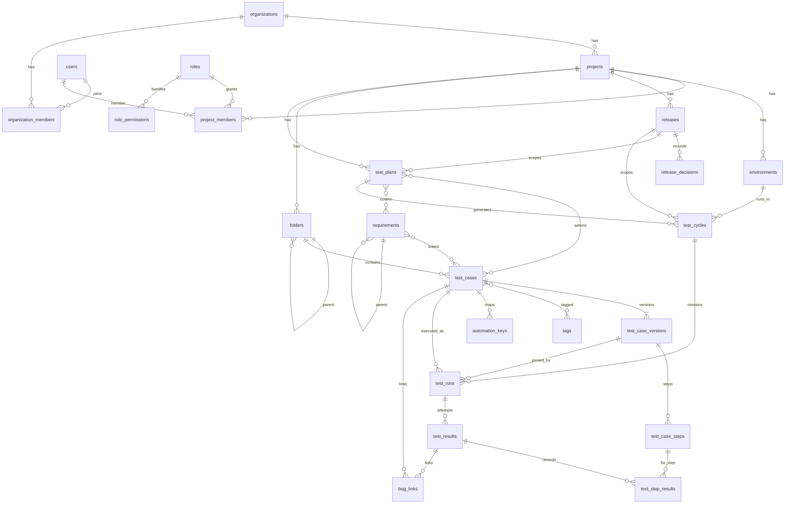

# 05 — Database Design

| Field | Value |
| --- | --- |
| Version | 1.0 · 2026-11-03 |
| DBMS | PostgreSQL 16 (extensions: `pg_trgm`, `unaccent`, `citext`) |
| Depends on | [02 Functional Spec](02-Functional-Specification.md), [03 HLD §6](03-HLD.md) |

This is the authoritative storage model. Its **executable form** is in [`schema/`](schema/): `00_roles.sql` (cluster roles), `01_baseline.sql` (every MVP table, enum, index, trigger and grant), `02_seed_system.sql` (system roles and permissions), `03_m1_additions.sql` (M1: sessions MFA counter, auth rate limits) and `99_verify.sql` (35 executable checks of the invariants in §4, run as `tcms_app`). The baseline was applied to PostgreSQL 16.15 and all checks pass. Where this prose and the SQL differ, **the SQL wins**; fix the prose. The first Alembic migration must produce exactly the baseline schema (it may execute `01_baseline.sql` verbatim). Phase 2/3 tables are listed in §7 and are **not** created in MVP migrations.

---

## 1. Conventions

| Item | Convention |
| --- | --- |
| Table names | plural snake_case (`test_cases`) |
| Primary key | `id uuid` (UUIDv7, generated by the application) |
| Foreign keys | `<entity>_id uuid`; `ON DELETE RESTRICT` unless stated; FK constraint name `fk_<table>_<column>` |
| Tenant columns | `organization_id uuid NOT NULL` on every tenant-owned table; `project_id uuid NOT NULL` on project-owned tables |
| Timestamps | `timestamptz NOT NULL DEFAULT now()`; `created_at`, `updated_at`; actor columns `created_by`, `updated_by` (uuid → users) |
| Concurrency | `row_version integer NOT NULL DEFAULT 1` on mutable aggregates; incremented by the application |
| Soft archive | `archived_at timestamptz NULL` (+ `archived_by`) |
| Text limits | Enforced with `CHECK (char_length(col) <= n)` where the functional spec defines a limit; Markdown fields `text` with ≤ 20,000 check |
| Enums | PostgreSQL enum types (§2); add values only (never remove/rename without a migration plan) |
| JSON | `jsonb` only for genuinely variable data (settings, audit changes, job payloads, snapshot counters) |
| Index names | `ix_<table>__<cols>`; unique `ux_<table>__<cols>` |
| Case-insensitive | `citext` for emails; `lower(name)` unique indexes for names |

Common column block "**std**" = `created_at`, `created_by`, `updated_at`, `updated_by`, `row_version`.

## 2. Enum types

| Type | Values |
| --- | --- |
| `project_status` | active, archived |
| `release_status` | planned, active, released, archived |
| `release_decision_kind` | go, go_with_risks, no_go |
| `priority_level` | critical, high, medium, low |
| `case_status` | draft, in_review, approved, deprecated, archived |
| `case_format` | steps, text *(P2 add: exploratory, data_validation; P3: bdd)* |
| `case_type` | functional, integration, end_to_end, api, ui, data_validation, performance, security, compatibility, usability |
| `design_technique` | positive, negative, boundary_value, equivalence_partitioning, error_guessing |
| `automation_status` | manual, automated, to_be_automated, not_automatable |
| `approval_mode` | auto, manual |
| `case_link_type` | related, duplicated_from |
| `plan_type` | functional, integration, regression, release_validation, uat, smoke, performance, security |
| `plan_status` | draft, active, completed, archived |
| `cycle_status` | planned, active, closed |
| `run_status` | not_run, in_progress, passed, failed, blocked, skipped, not_applicable |
| `result_state` | draft, final |
| `result_status` | passed, failed, blocked, skipped, not_applicable |
| `step_status` | not_run, passed, failed, blocked, skipped |
| `result_source` | manual, automation |
| `defect_status` | open, triaged, assigned, in_progress, fixed, ready_for_retest, verified, closed, reopened, rejected, duplicate, cannot_reproduce, deferred |
| `defect_resolution` | fixed, wont_fix, duplicate, cannot_reproduce, not_a_bug, deferred |
| `requirement_type` | epic, feature, user_story, functional, non_functional, business |
| `requirement_status` | draft, approved, implemented, obsolete |
| `requirement_source` | internal, jira |
| `actor_type` | user, api_token, system, integration |
| `job_status` | queued, running, succeeded, failed, dead |
| `transfer_kind` | import, export |
| `transfer_status` | uploaded, validating, validated, committing, committed, generating, ready, failed, expired |
| `view_visibility` | private, project |
| `token_scope` | read, read_write |

## 3. Tables

### 3.1 Identity and organization

**organizations**

| Column | Type | Null | Default | Notes |
| --- | --- | --- | --- | --- |
| id | uuid | no | | PK |
| name | text | no | | 1–100 |
| slug | text | no | | unique, immutable |
| settings | jsonb | no | `{}` | `mfa_required_for_all`, `session_idle_minutes` (30), `session_absolute_hours` (12), `qa_managers_can_create_projects` (true), `default_attachment_max_mb` (25), `audit_retention_years` (3) |
| std | | | | |

Indexes: `ux_organizations__slug`.

**users**

| Column | Type | Null | Default | Notes |
| --- | --- | --- | --- | --- |
| id | uuid | no | | PK |
| email | citext | no | | unique |
| display_name | text | no | | 1–100 |
| password_hash | text | yes | | Argon2id; null until invitation accepted (or SSO-only P2) |
| time_zone | text | no | `'UTC'` | IANA name |
| is_active | boolean | no | true | |
| failed_login_count | int | no | 0 | rolling window counter |
| locked_until | timestamptz | yes | | |
| last_login_at | timestamptz | yes | | |
| password_changed_at | timestamptz | yes | | |
| preferences | jsonb | no | `{}` | email opt-outs, theme |
| std | | | | |

Indexes: `ux_users__email`. Users are global to the deployment; organization membership via `organization_members` (MVP: each user belongs to exactly one organization — enforced by unique `organization_members(user_id)`; relaxable later).

**organization_members**

| Column | Type | Null | Notes |
| --- | --- | --- | --- |
| organization_id | uuid | no | PK part, FK |
| user_id | uuid | no | PK part, FK; `ux_organization_members__user_id` (MVP) |
| is_org_admin | boolean | no | default false |
| joined_at | timestamptz | no | |
| granted_by | uuid | yes | |

**roles**

| Column | Type | Null | Notes |
| --- | --- | --- | --- |
| id | uuid | no | PK |
| organization_id | uuid | yes | null = system role |
| code | text | no | `qa_manager`, `qa_lead`, `qa_engineer`, `developer`, `pm_ba`, `viewer` (system) |
| name | text | no | |
| description | text | yes | |
| is_system | boolean | no | true for seeded roles (read-only) |
| std | | | |

Indexes: `ux_roles__organization_id_code` on `(coalesce(organization_id, tcms_nil_uuid()), code)`. `CHECK (is_system = (organization_id IS NULL))`.

**role_permissions**: `role_id uuid FK ON DELETE CASCADE`, `permission text` (must be in code catalog — validated by app), PK `(role_id, permission)`.

**project_members**

| Column | Type | Null | Notes |
| --- | --- | --- | --- |
| project_id | uuid | no | PK part, FK |
| user_id | uuid | no | PK part, FK |
| organization_id | uuid | no | |
| role_id | uuid | no | FK roles |
| granted_by | uuid | yes | |
| granted_at | timestamptz | no | |

Indexes: `ix_project_members__user_id`.

**user_mfa**: `user_id uuid PK FK`, `totp_secret_enc bytea NOT NULL` (AES-GCM with key-id prefix), `enrolled_at timestamptz`, `last_used_step bigint` (replay protection).

**mfa_recovery_codes**: `id uuid PK`, `user_id uuid FK`, `code_hash text`, `used_at timestamptz NULL`, `created_at`. Index `ix_mfa_recovery_codes__user_id`.

**sessions**

| Column | Type | Notes |
| --- | --- | --- |
| id | uuid | PK |
| token_hash | bytea | SHA-256 of cookie token; unique |
| user_id | uuid | FK |
| organization_id | uuid | |
| created_at | timestamptz | |
| last_seen_at | timestamptz | updated ≤ once/min |
| expires_at | timestamptz | absolute expiry |
| mfa_verified | boolean | |
| ip | inet | |
| user_agent | text | ≤ 500 |
| revoked_at | timestamptz | null |
| mfa_failed_attempts | smallint | default 0; pending sign-in invalidated at 5 (migration 0002) |

Indexes: `ux_sessions__token_hash`, `ix_sessions__user_id`, `ix_sessions__expires_at`.

**api_tokens**: `id uuid PK`, `organization_id`, `user_id FK`, `name text` (1–100), `token_prefix text` (first 8 chars, for display), `token_hash bytea unique`, `scope token_scope`, `project_id uuid NULL` (restriction), `expires_at timestamptz NOT NULL`, `last_used_at`, `revoked_at`, `created_at`. Index `ix_api_tokens__user_id`.

**password_reset_tokens**: `id`, `user_id`, `token_hash bytea unique`, `expires_at`, `used_at`, `created_at`.

**invitations**: `id`, `organization_id`, `email citext`, `token_hash bytea unique`, `is_org_admin boolean` (default false), `project_id NULL`, `role_id NULL` (`CHECK ((project_id IS NULL) = (role_id IS NULL))`), `invited_by`, `expires_at`, `accepted_at`, `revoked_at`, `created_at`. Index `ix_invitations__organization_id_email`.

**auth_rate_limits** (migration 0002): `bucket_key text PK` (e.g. `auth:<ip>`), `window_start timestamptz`, `count int`; index on `window_start`; rows older than 1 h purged by `sessions.cleanup`.

**login_attempts**: `id bigserial PK`, `email citext`, `ip inet`, `succeeded boolean`, `occurred_at timestamptz`. Indexes `(email, occurred_at)`, `(ip, occurred_at)`. Purged after 30 days.

### 3.2 Workspace

**projects**

| Column | Type | Null | Default | Notes |
| --- | --- | --- | --- | --- |
| id | uuid | no | | PK |
| organization_id | uuid | no | | FK |
| key | text | no | | `CHECK (key ~ '^[A-Z][A-Z0-9]{1,9}$')` |
| name | text | no | | 1–100 |
| description | text | yes | | |
| status | project_status | no | active | |
| settings | jsonb | no | `{}` | `approval_required` false, `allow_self_approval` false, `only_assignee_executes` false, `report_module_depth` 1, `attachment_max_mb` 25, `require_bug_link_for_failure` false, `bug_tracker_name` `tracker`, `bug_url_template` null (M5 migration renamed `require_defect_for_failure`) |
| archived_at, archived_by | | yes | | |
| std | | | | |

Indexes: `ux_projects__organization_id_key`, `ux_projects__organization_id_lower_name WHERE status='active'`.

**environments**: `id`, `organization_id`, `project_id FK`, `name` (1–50), `description`, `archived_at`, std. Unique `(project_id, lower(name))`.

**releases**

| Column | Type | Null | Notes |
| --- | --- | --- | --- |
| id | uuid | no | PK |
| organization_id, project_id | uuid | no | |
| name | text | no | 1–50; unique `(project_id, lower(name))` |
| description | text | yes | |
| status | release_status | no | default planned |
| start_date, target_date | date | yes | `CHECK (target_date IS NULL OR start_date IS NULL OR target_date >= start_date)` |
| released_at | timestamptz | yes | |
| std, archived_at | | | |

**release_decisions** (append-only)

| Column | Type | Notes |
| --- | --- | --- |
| id | uuid | PK |
| organization_id, project_id, release_id | uuid | FK |
| decision | release_decision_kind | |
| comment | text | required |
| risks | text | required when go_with_risks (`CHECK`) |
| snapshot | jsonb | rule evaluations + metrics at decision time |
| decided_by | uuid | |
| decided_at | timestamptz | |

Index `ix_release_decisions__release_id_decided_at`.

**key_sequences**: `project_id uuid`, `entity text` (`test_case`, `test_plan`, `test_cycle`, `defect`, `requirement`), `next_value bigint NOT NULL DEFAULT 1`; PK `(project_id, entity)`.

### 3.3 Test design

**folders**

| Column | Type | Null | Notes |
| --- | --- | --- | --- |
| id | uuid | no | PK |
| organization_id, project_id | uuid | no | |
| parent_id | uuid | yes | FK folders(id) |
| name | text | no | 1–120, `CHECK (position('/' in name) = 0)` |
| description | text | yes | |
| position | int | no | sibling order |
| path | text | no | materialized path of IDs `"/<root-id>/<child-id>/"`; maintained by service on create/move |
| depth | smallint | no | 1..10, `CHECK (depth BETWEEN 1 AND 10)` |
| case_count | int | no | default 0; direct non-archived cases (maintained) |
| archived_at, archived_by | | yes | |
| std | | | |

Indexes: `ux_folders__project_parent_lower_name` (unique on `(project_id, coalesce(parent_id, tcms_nil_uuid()), lower(name))`), `ix_folders__project_id_path` (`text_pattern_ops` for prefix search), `ix_folders__parent_id`.

**test_cases**

| Column | Type | Null | Default | Notes |
| --- | --- | --- | --- | --- |
| id | uuid | no | | PK |
| organization_id, project_id | uuid | no | | |
| key_num | bigint | no | | |
| key | text | no | | e.g. `SPARK-TC-1042` |
| folder_id | uuid | no | | FK folders |
| title | text | no | | denormalized from latest version |
| format | case_format | no | steps | denormalized from latest version |
| type | case_type | no | functional | |
| design_technique | design_technique | yes | | |
| priority | priority_level | no | medium | |
| status | case_status | no | | |
| owner_id | uuid | no | | FK users |
| reviewer_id | uuid | yes | | |
| automation_status | automation_status | no | manual | |
| estimated_minutes | int | yes | | 0–1440 |
| latest_version_id | uuid | yes | | FK test_case_versions (deferrable initially deferred — set in same tx) |
| approved_version_id | uuid | yes | | FK test_case_versions |
| latest_version_no | int | no | 1 | denormalized |
| search_vector | tsvector | no | | maintained by app on version create: weights A=key+title, B=description |
| archived_at, archived_by | | yes | | |
| std | | | | |

Indexes: `ux_test_cases__project_id_key_num`, `ux_test_cases__project_id_key`, `ix_test_cases__project_folder_status (project_id, folder_id, status)`, `ix_test_cases__project_status_priority`, `ix_test_cases__owner_id`, GIN `ix_test_cases__search_vector`, GIN trigram `ix_test_cases__title_trgm (title gin_trgm_ops)`.

**test_case_versions** (immutable; approval columns set once)

| Column | Type | Null | Notes |
| --- | --- | --- | --- |
| id | uuid | no | PK |
| organization_id, project_id | uuid | no | |
| test_case_id | uuid | no | composite FK `(project_id, test_case_id)` → test_cases ON DELETE CASCADE (reached only via `purge_test_case`) |
| version_no | int | no | unique `(test_case_id, version_no)` |
| format | case_format | no | |
| title | text | no | 3–255 |
| description, preconditions, test_data, expected_result, postconditions, text_body | text | yes | ≤ 20,000 each |
| change_note | text | yes | ≤ 500 |
| content_hash | bytea | no | SHA-256 |
| created_by | uuid | no | |
| created_at | timestamptz | no | |
| submitted_by, submitted_at | | yes | review submission |
| approved_by | uuid | yes | null for auto |
| approved_at | timestamptz | yes | |
| approval_mode | approval_mode | yes | |

`CHECK (format <> 'text' OR text_body IS NOT NULL)`.

**test_case_steps** (immutable)

| Column | Type | Null | Notes |
| --- | --- | --- | --- |
| id | uuid | no | PK — the `step_id` referenced by step results |
| organization_id, project_id | uuid | no | |
| version_id | uuid | no | FK test_case_versions ON DELETE CASCADE |
| position | smallint | no | 1..100; unique `(version_id, position)` |
| action | text | no | 1–5,000 |
| expected_result | text | yes | ≤ 5,000 |
| data | text | yes | ≤ 2,000 |

**tags**: `id`, `organization_id`, `project_id`, `name text` (`CHECK (name ~ '^[a-z0-9._-]{1,40}$')`), `is_system boolean`, `created_at`, `created_by`. Unique `(project_id, name)`.

**test_case_tags**: `test_case_id FK ON DELETE CASCADE`, `tag_id FK ON DELETE CASCADE`, PK `(test_case_id, tag_id)`, index `ix_test_case_tags__tag_id`.

**test_case_links**: `id`, `organization_id`, `project_id`, `source_case_id`, `target_case_id`, `link_type case_link_type`, `created_at`, `created_by`. Unique `(source_case_id, target_case_id, link_type)`; `CHECK (source_case_id <> target_case_id)`. "related" is stored once with `source < target` (ordering check) and read in both directions.

**automation_keys**: `id`, `organization_id`, `project_id`, `test_case_id FK ON DELETE CASCADE`, `key text` (1–500), `created_at`, `created_by`. Unique `(project_id, key)`.

### 3.4 Planning

**test_plans**

| Column | Type | Null | Notes |
| --- | --- | --- | --- |
| id | uuid | no | PK |
| organization_id, project_id | uuid | no | |
| key_num, key | bigint, text | no | `SPARK-PL-n`; unique per project |
| name | text | no | 3–150 |
| type | plan_type | no | |
| status | plan_status | no | default draft |
| release_id | uuid | yes | FK releases |
| owner_id | uuid | no | |
| objectives, scope_in, scope_out, entry_criteria, exit_criteria_notes, acceptance_criteria | text | yes | Markdown |
| exit_rules | jsonb | no | `[]` — readiness rules ([02 §11.4](02-Functional-Specification.md)) |
| risks | jsonb | no | `[]` — `{description, impact, mitigation}` |
| member_ids | uuid[] | no | `{}` |
| start_date, end_date | date | yes | end ≥ start |
| archived_at | | yes | |
| std | | | |

Indexes: `ux_test_plans__project_id_key_num`, `ix_test_plans__project_release`.

**test_plan_cases**: `plan_id FK ON DELETE CASCADE`, `test_case_id FK`, `organization_id`, `project_id`, `added_at`, `added_by`; PK `(plan_id, test_case_id)`; index `ix_test_plan_cases__test_case_id`.

**test_plan_requirements**: `plan_id`, `requirement_id`, `organization_id`, `project_id`, `added_at`, `added_by`; PK `(plan_id, requirement_id)`; index on `requirement_id`.

**test_plan_environments**: `plan_id`, `environment_id`; PK both.

### 3.5 Execution

**test_cycles**

| Column | Type | Null | Notes |
| --- | --- | --- | --- |
| id | uuid | no | PK |
| organization_id, project_id | uuid | no | |
| key_num, key | | no | `SPARK-CY-n` |
| name | text | no | 3–150 |
| description | text | yes | |
| release_id | uuid | yes | FK |
| plan_id | uuid | yes | FK |
| environment_id | uuid | no | FK |
| build | text | yes | ≤ 100 |
| status | cycle_status | no | default planned |
| start_date, due_date | date | yes | |
| owner_id | uuid | no | |
| runs_pending | boolean | no | default false (background run creation) |
| started_at | timestamptz | yes | |
| closed_at, closed_by | | yes | |
| archived_at | | yes | |
| std | | | |

Indexes: `ux_test_cycles__project_id_key_num`, `ix_test_cycles__project_status`, `ix_test_cycles__release_id`, `ix_test_cycles__plan_id`.

**test_runs**

| Column | Type | Null | Notes |
| --- | --- | --- | --- |
| id | uuid | no | PK |
| organization_id, project_id | uuid | no | |
| cycle_id | uuid | no | FK test_cycles |
| test_case_id | uuid | no | FK test_cases |
| test_case_version_id | uuid | no | FK test_case_versions (pinned) |
| position | int | no | order in cycle |
| assignee_id | uuid | yes | |
| status | run_status | no | default not_run (BR-08, maintained) |
| latest_result_id | uuid | yes | FK test_results (deferrable) |
| needs_retest | boolean | no | default false |
| superseded_by_run_id | uuid | yes | FK test_runs, **DEFERRABLE INITIALLY DEFERRED** (Replace run marks the old run before the new one exists) |
| superseded_at | timestamptz | yes | |
| std | | | |

Constraints and indexes:
- `ux_test_runs__cycle_case_active` UNIQUE `(cycle_id, test_case_id) WHERE superseded_by_run_id IS NULL` (BR-12)
- `ix_test_runs__cycle_status (cycle_id, status) WHERE superseded_by_run_id IS NULL`
- `ix_test_runs__assignee_status (assignee_id, status) WHERE superseded_by_run_id IS NULL`
- `ix_test_runs__test_case_id`
- `ix_test_runs__cycle_position (cycle_id, position)`
- Composite FKs `(project_id, cycle_id)` and `(project_id, test_case_id)` guarantee cycle and case are in the run's project; trigger `trg_test_runs_version_check` guarantees the pinned version belongs to the run's case.

**test_results** (attempts)

| Column | Type | Null | Notes |
| --- | --- | --- | --- |
| id | uuid | no | PK |
| organization_id, project_id | uuid | no | |
| run_id | uuid | no | FK test_runs |
| attempt_no | int | no | unique `(run_id, attempt_no)` |
| state | result_state | no | draft/final |
| status | result_status | yes | `CHECK ((state='draft' AND status IS NULL) OR (state='final' AND status IS NOT NULL))` |
| source | result_source | no | default manual |
| executed_by | uuid | yes | null for automation |
| started_at | timestamptz | no | |
| finished_at | timestamptz | yes | required when final (`CHECK`) |
| duration_seconds | int | yes | 0–86,400 |
| build | text | yes | |
| environment_id | uuid | no | |
| comment | text | yes | |
| reason | text | yes | ≤ 1,000 |
| skipped_steps | smallint | no | default 0 |
| corrects_result_id | uuid | yes | FK test_results |
| automation_meta | jsonb | yes | P2: ci_url, failure message, test name |
| updated_at, updated_by | | | draft edits |

Indexes: `ux_test_results__run_draft UNIQUE (run_id) WHERE state='draft'` (BR-07), `ix_test_results__run_id_attempt`, `ix_test_results__project_finished (project_id, finished_at) WHERE state='final'`, `ix_test_results__executed_by_finished`.

**test_step_results**

| Column | Type | Null | Notes |
| --- | --- | --- | --- |
| id | uuid | no | PK |
| organization_id, project_id | uuid | no | |
| result_id | uuid | no | FK test_results ON DELETE CASCADE (drafts only, trigger) |
| step_id | uuid | no | FK test_case_steps |
| position | smallint | no | copy of step position |
| status | step_status | no | default not_run |
| actual_result | text | yes | ≤ 20,000 |
| comment | text | yes | |
| updated_at, updated_by | | | |

Unique `(result_id, step_id)`; index `(result_id, position)`.

### 3.6 Bug links (M5, ADR-023; `docs/schema/04_m5_bug_links.sql`)

Bugs live in each team's tracker; Assay stores references to them.

**bug_links**

| Column | Type | Null | Notes |
| --- | --- | --- | --- |
| id | uuid | no | PK |
| organization_id, project_id | uuid | no | composite FK to projects |
| reference | text | no | 1–100, trimmed (`SPK-431`, `#1287`) |
| reference_norm | text | no | `upper(reference)`; grouping and duplicate check |
| url | text | yes | ≤ 2,000, `^https?://` |
| title | text | yes | ≤ 255 |
| test_case_id | uuid | no | composite FK test_cases (always set) |
| run_id, result_id | uuid | yes | composite FKs; set together (`CHECK ((result_id IS NULL) = (run_id IS NULL))`) |
| step_id | uuid | yes | FK test_case_steps; only with a result |
| std | | | |

Unique `ux_bug_links__target (project_id, reference_norm, test_case_id, coalesce(result_id, nil), coalesce(step_id, nil))`; indexes `(project_id, reference_norm)`, `run_id`, `result_id`, `test_case_id`. Not part of the attempt: rows may be added to final attempts; a discarded draft's rows are deleted by the service before the attempt.

### 3.6b Defects (unused since ADR-023; reserved for a tracker connector)

The baseline tables below exist but hold no data.


**defects**

| Column | Type | Null | Notes |
| --- | --- | --- | --- |
| id | uuid | no | PK |
| organization_id, project_id | uuid | no | |
| key_num, key | | no | `SPARK-D-n` |
| title | text | no | 5–255 |
| description, steps_to_reproduce, expected_result, actual_result | text | (steps/expected/actual no) | Markdown |
| severity | priority_level | no | default medium |
| priority | priority_level | no | default medium |
| status | defect_status | no | default open |
| environment_id | uuid | yes | |
| build | text | yes | |
| browser_device | text | yes | ≤ 200 |
| folder_id | uuid | yes | "module" |
| found_in_release_id | uuid | yes | |
| fix_version | text | yes | |
| reporter_id | uuid | no | |
| assignee_id | uuid | yes | |
| resolution | defect_resolution | yes | |
| resolution_note | text | yes | |
| duplicate_of_id | uuid | yes | FK defects; `CHECK (duplicate_of_id <> id)` |
| external_owner | text | yes | null (TCMS) or `jira` (P2) |
| resolved_at | timestamptz | yes | set when entering resolved set |
| search_vector | tsvector | no | |
| std | | | |

Indexes: `ux_defects__project_id_key_num`, `ix_defects__project_status_severity`, `ix_defects__assignee_status`, `ix_defects__found_in_release`, `ix_defects__folder_id`, GIN search, trigram title.

**defect_links**

| Column | Type | Null | Notes |
| --- | --- | --- | --- |
| id | uuid | no | PK |
| organization_id, project_id | uuid | no | |
| defect_id | uuid | no | FK ON DELETE CASCADE |
| result_id | uuid | yes | FK test_results |
| run_id | uuid | yes | FK test_runs (set with result) |
| step_id | uuid | yes | FK test_case_steps |
| test_case_id | uuid | yes | FK test_cases |
| requirement_id | uuid | yes | FK requirements |
| created_at, created_by | | | |

`CHECK (result_id IS NOT NULL OR test_case_id IS NOT NULL OR requirement_id IS NOT NULL)`; `CHECK ((result_id IS NULL) = (run_id IS NULL))`; unique `(defect_id, coalesce(result_id, tcms_nil_uuid()), coalesce(test_case_id, tcms_nil_uuid()), coalesce(requirement_id, tcms_nil_uuid()))` via expression index; indexes on each FK.

**defect_status_history** (append-only): `id`, `organization_id`, `project_id`, `defect_id`, `from_status defect_status NULL`, `to_status defect_status`, `note text`, `changed_by`, `changed_at`. Index `(defect_id, changed_at)`.

**defect_watchers**: `defect_id`, `user_id`, PK both.

### 3.7 Requirement references (M6, ADR-024; `docs/schema/05_m6_requirement_refs.sql`)

Requirements live in each team's tool; Assay stores references to them, links them to cases and plans, and computes coverage (docs/04 §7).

**requirement_refs**

| Column | Type | Null | Notes |
| --- | --- | --- | --- |
| id | uuid | no | PK; unique `(project_id, id)` for composite FKs |
| organization_id, project_id | uuid | no | composite FK to projects |
| reference | text | no | 1–100, trimmed (`SPK-120`) |
| reference_norm | text | no | `upper(reference)`; duplicate check and search |
| url | text | yes | ≤ 2,000, `^https?://`; when null the UI builds one from `requirement_url_template` (falls back to `bug_url_template`) |
| title | text | yes | ≤ 255; a label only, not synced |
| archived_at | timestamptz | yes | archived references keep their links but leave coverage |
| std | | | |

Indexes: `ux_requirement_refs__project_reference (project_id, reference_norm)`, trigram `ix_requirement_refs__reference_trgm`, `ix_requirement_refs__title_trgm`.

**requirement_ref_cases**: `ref_id`, `test_case_id`, `organization_id`, `project_id`, `created_at`, `created_by`; PK `(ref_id, test_case_id)`; composite FKs `(project_id, ref_id)` and `(project_id, test_case_id)`, both ON DELETE CASCADE; index `ix_requirement_ref_cases__test_case_id`.

**plan_requirement_refs**: `plan_id`, `ref_id`, `organization_id`, `project_id`, `created_at`, `created_by`; PK `(plan_id, ref_id)`; composite FKs ON DELETE CASCADE; index `ix_plan_requirement_refs__ref_id`. A reference is in scope for release R when a plan of R lists it or a linked case ran in a cycle of R.

The same migration adds trigram indexes for global search: `ix_bug_links__reference_trgm`, `ix_test_cycles__name_trgm`, `ix_test_plans__name_trgm`.

### 3.7b Requirements (unused since ADR-024; reserved for a requirements connector)

The baseline tables below (and `test_plan_requirements`) exist but hold no data.

**requirements**

| Column | Type | Null | Notes |
| --- | --- | --- | --- |
| id | uuid | no | PK |
| organization_id, project_id | uuid | no | |
| key_num, key | | no | `SPARK-R-n` |
| external_key | text | yes | P2 Jira key |
| title | text | no | 3–255 |
| description, acceptance_criteria | text | yes | |
| type | requirement_type | no | |
| priority | priority_level | no | default medium |
| status | requirement_status | no | default draft |
| owner_id | uuid | yes | |
| target_release_id | uuid | yes | FK releases |
| parent_id | uuid | yes | FK requirements; depth ≤ 5 (service) |
| source | requirement_source | no | default internal |
| search_vector | tsvector | no | |
| archived_at | | yes | |
| std | | | |

Indexes: `ux_requirements__project_id_key_num`, `ix_requirements__project_release`, `ix_requirements__parent_id`, GIN search.

**requirement_case_links**: `requirement_id FK ON DELETE CASCADE`, `test_case_id FK`, `organization_id`, `project_id`, `created_at`, `created_by`; PK `(requirement_id, test_case_id)`; index `ix_requirement_case_links__test_case_id`.

### 3.8 Platform

**comments**: `id`, `organization_id`, `project_id`, `entity_type text` (`test_case`, `test_case_version`, `test_result`, `test_run`, `defect`, `requirement`, `test_plan`, `test_cycle`), `entity_id uuid`, `body text` (≤ 10,000), `mentions uuid[]`, `created_at`, `created_by`, `edited_at`, `deleted_at`. Index `(entity_type, entity_id, created_at)`.

**attachments**

| Column | Type | Notes |
| --- | --- | --- |
| id | uuid | PK |
| organization_id, project_id | uuid | |
| object_key | text | S3 key, unique |
| file_name | text | sanitized original name ≤ 255 |
| content_type | text | sniffed |
| size_bytes | bigint | |
| sha256 | bytea | |
| uploaded_by | uuid | |
| uploaded_at | timestamptz | |
| deleted_at | timestamptz | soft-delete; object removed by GC job |

**attachment_links**: `id`, `attachment_id FK`, `organization_id`, `project_id`, `entity_type text` (as comments + `test_case_step`, `test_step_result`), `entity_id uuid`, `created_at`, `created_by`. Unique `(attachment_id, entity_type, entity_id)`; index `(entity_type, entity_id)`.

**notifications**: `id`, `organization_id`, `user_id`, `type text`, `entity_type`, `entity_id`, `project_id`, `payload jsonb`, `created_at`, `read_at`. Index `(user_id, read_at, created_at DESC)`.

**saved_views**: `id`, `organization_id`, `project_id`, `owner_id`, `entity_type text` (`test_case`, `test_run`, `defect`, `requirement`, `audit_event`, `report:<name>`), `name` (1–100), `visibility view_visibility`, `definition jsonb` (`{filters, columns, sort}`), `is_default boolean`, std. Unique `(project_id, owner_id, entity_type, lower(name))`.

**audit_events** (append-only; partition-ready by month)

| Column | Type | Notes |
| --- | --- | --- |
| id | uuid | PK |
| occurred_at | timestamptz | |
| organization_id | uuid | |
| project_id | uuid | null for org-level |
| actor_type | actor_type | |
| actor_id | uuid | user or token or null (system) |
| actor_display | text | name at time of event |
| action | text | e.g. `test_case.version_created` |
| entity_type | text | |
| entity_id | uuid | |
| entity_key | text | |
| changes | jsonb | `{field: [old, new]}` |
| context | jsonb | request_id, ip, user_agent, bulk_operation_id, reason |
| summary | text | rendered sentence |
| prev_hash, hash | bytea | P2 hash chain (nullable in MVP) |

Indexes: `ix_audit_events__org_occurred (organization_id, occurred_at DESC)`, `ix_audit_events__project_occurred`, `ix_audit_events__entity (entity_type, entity_id, occurred_at DESC)`, `ix_audit_events__actor (actor_id, occurred_at DESC)`, `ix_audit_events__action`.

**jobs**: as in [03 HLD §10](03-HLD.md): `id`, `organization_id NULL`, `type text`, `payload jsonb`, `status job_status`, `run_at`, `attempts int`, `max_attempts int`, `last_error text`, `locked_by text`, `locked_at`, `dedupe_key text NULL`, `created_at`, `finished_at`. Indexes: `ix_jobs__queue (run_at) WHERE status='queued'`, `ix_jobs__running_locked (locked_at) WHERE status='running'`, `ux_jobs__dedupe_key WHERE dedupe_key IS NOT NULL AND status IN ('queued','running')`. Status semantics: `failed` = permanent error raised by a handler (no retry); `dead` = retries exhausted; a retryable failure returns to `queued` with backoff.

**data_transfers**: `id`, `organization_id`, `project_id`, `kind transfer_kind`, `entity text` (`test_case`, `requirement`, `defect`, `report:<name>`), `status transfer_status`, `format text` (`csv`, `xlsx`), `source_object_key`, `result_object_key`, `options jsonb` (mapping, mode, filters), `summary jsonb` (counts), `errors jsonb` (first 1,000 row errors), `created_by`, `created_at`, `finished_at`, `expires_at`.

**metric_snapshots**: `id`, `organization_id`, `project_id`, `release_id NULL`, `cycle_id NULL`, `day date`, `counters jsonb`, `created_at`. Unique `(project_id, coalesce(release_id, tcms_nil_uuid()), coalesce(cycle_id, tcms_nil_uuid()), day)`.

**idempotency_keys**: `key text`, `principal_id uuid`, `endpoint text`, `request_hash bytea`, `response_status int`, `response_body jsonb`, `created_at`; PK `(principal_id, key)`; purged after 24 h.

## 4. Integrity rules in the database

| Rule | Implementation |
| --- | --- |
| Version immutability (BR-01) | `trg_test_case_versions_guard`: content columns can never change; `submitted_*` may change; `approved_*`/`approval_mode` can be set once (NULL → value); DELETE only when `current_user = 'tcms_owner'` (inside `purge_test_case`) |
| Step immutability | `trg_test_case_steps_guard`: no UPDATE; DELETE only as `tcms_owner` |
| Final result immutability (BR-06) | `trg_test_results_guard`: if `OLD.state='final'` → raise on UPDATE/DELETE |
| Final step results immutability | `trg_test_step_results_guard`: raise on INSERT/UPDATE/DELETE if parent result is final |
| Step belongs to pinned version | `trg_test_step_results_step_check`: a step result's `step_id` must be a step of the run's pinned version |
| Append-only tables (BR-26) | `tcms_append_only_guard` triggers on `audit_events`, `defect_status_history`, `release_decisions` (DELETE only as `tcms_owner`, for retention purge); app role also lacks UPDATE/DELETE privileges |
| Same-tenant and same-project relations | `projects` has `UNIQUE (organization_id, id)`; project-owned tables reference it with composite FK `(organization_id, project_id)`. Aggregates referenced across modules (`test_cases`, `requirements`, `test_plans`, `test_cycles`, `test_runs`, `test_results`, `defects`) have `UNIQUE (project_id, id)`, and children reference them with composite FKs `(project_id, <parent>_id)`. A row can therefore never point at another project's or organization's data. |
| One draft per run (BR-07) | Partial unique index |
| One active run per case per cycle (BR-12) | Partial unique index |
| Case hard delete (BR-14) | Function `purge_test_case(case_id)` (SECURITY DEFINER, owned by `tcms_owner`): raises `case_has_runs` if any run references the case; removes plan memberships and case-only defect links, then deletes the case (cascading to versions, steps, tags, links, automation keys). Immutability triggers permit these deletes only because the function runs as `tcms_owner`. A session setting is deliberately **not** used as the bypass: the app role could set it itself (`99_verify.sql` checks this) |

```sql
CREATE FUNCTION tcms_raise_immutable() RETURNS trigger LANGUAGE plpgsql AS $$
BEGIN
  RAISE EXCEPTION 'immutable_record: % on %', TG_OP, TG_TABLE_NAME USING ERRCODE = 'P0001';
END $$;

CREATE FUNCTION tcms_test_results_guard() RETURNS trigger LANGUAGE plpgsql AS $$
BEGIN
  IF OLD.state = 'final' THEN
    RAISE EXCEPTION 'immutable_record: final result %', OLD.id USING ERRCODE = 'P0001';
  END IF;
  RETURN CASE WHEN TG_OP = 'DELETE' THEN OLD ELSE NEW END;
END $$;
CREATE TRIGGER trg_test_results_guard BEFORE UPDATE OR DELETE ON test_results
  FOR EACH ROW EXECUTE FUNCTION tcms_test_results_guard();
```

The API maps SQLSTATE `P0001` with message prefix `immutable_record` to `409 immutable_record` (should never surface if services are correct; a surfaced one is a bug and is logged at ERROR).

### Database roles

| Role | Privileges |
| --- | --- |
| `tcms_owner` | Owns schema; runs migrations and maintenance (retention purge, case purge function owner) |
| `tcms_app` | SELECT/INSERT/UPDATE/DELETE on all tables **except** INSERT/SELECT only on `audit_events`, `defect_status_history`, `release_decisions`; EXECUTE on `purge_test_case` |
| `tcms_readonly` | SELECT (optional, for BI/backups verification) |

## 5. Index and query plan notes

| Query | Index used |
| --- | --- |
| Repository list by folder subtree | `folders.path LIKE '/root/x/%'` → `ix_folders__project_id_path`; cases by `folder_id = ANY(...)` + status → `ix_test_cases__project_folder_status` |
| Cycle runs page (filter status/assignee) | `ix_test_runs__cycle_status`, `ix_test_runs__cycle_position` |
| My Work | `ix_test_runs__assignee_status` |
| Execution summary | `ix_test_runs__cycle_status` (index-only scan with `status`) |
| Case execution history | `ix_test_runs__test_case_id` → results by `run_id` |
| Results history report | `ix_test_results__project_finished` |
| Bugs list / chips | `ix_bug_links__project_reference`, `ix_bug_links__run_id` |
| Search | GIN `search_vector`, trigram title |
| Audit per record | `ix_audit_events__entity` |

Partitioning: `audit_events` and `test_results` are declared as regular tables in MVP; when either exceeds 50 M rows, convert to monthly range partitions (migration plan in ADR-016).

## 6. Entity-relationship diagram (MVP core)



## 7. Phase 2/3 tables (not in MVP migrations)

| Table | Phase | Purpose |
| --- | --- | --- |
| `integration_connections` | P2 | `id, organization_id, type, name, config jsonb, secrets_enc bytea, status, last_checked_at, last_error, std` |
| `external_links` | P2 | `id, organization_id, project_id, entity_type, entity_id, connection_id, external_key, external_id, url, owner ('tcms'|'external'), mirror jsonb, synced_at, sync_error`; unique `(connection_id, external_id, entity_type)` |
| `project_integration_mappings` | P2 | TCMS project ↔ external project, issue types, field and status maps |
| `automation_imports` | P2 | Import records: file key, counts, unmatched list, CI metadata |
| `shared_step_blocks`, `shared_step_block_versions`, `shared_step_block_steps` | P2 | Shared steps |
| `test_case_parameters`, `test_case_datasets` | P2 | Parameters/datasets; `test_runs.dataset_row jsonb` added |
| `configurations`, `configuration_values` | P2 | Configuration matrix; `test_runs.configuration_id` added and the BR-12 unique index extended to include it |
| `exploratory_sessions`, `session_notes` | P2 | Exploratory execution |
| `data_validation_checks`, `check_results` | P2 | Data-validation format |
| `custom_field_definitions`, `test_case_custom_values` | P2 | Custom fields |
| `oidc_identities` | P2 | `user_id, provider, subject` |

## 8. Migration strategy

1. **Tooling:** Alembic with autogenerate as a draft only; every migration hand-reviewed. Migration file names `YYYYMMDD_HHMM_<slug>.py`.
2. **Baseline:** first migration creates extensions, enum types, roles' grants (via owner), all MVP tables, triggers, functions, seed system roles + permissions, system tags created per project at project creation (not in migration).
3. **Forward-only:** no downgrades in production; `downgrade()` implemented for local dev only where trivial.
3a. **Baseline execution and grants:** migration `0001_baseline` executes `01_baseline.sql` and `02_seed_system.sql` verbatim (their outer `BEGIN`/`COMMIT` removed); both files are frozen once released and later changes add `docs/schema/NN_<slug>.sql`. The baseline grants privileges only on tables existing at that time (no default privileges), so every later migration that creates a table calls the `grant_app()` helper; a test asserts `tcms_app` privileges on every table. See [ops/migrations.md](ops/migrations.md).
4. **Expand → migrate → contract** for breaking changes: add new nullable column/table → deploy code writing both → backfill in batches (jobs) → switch reads → drop old in a later release.
5. **Enum changes:** `ALTER TYPE … ADD VALUE` in its own migration (cannot run inside a transaction with other statements on PG < 12 semantics; keep isolated).
6. **Large backfills:** batched (10,000 rows), resumable, run as jobs, never in the migration transaction.
7. **Testing:** CI runs `alembic upgrade head` on an empty DB (and, from the first release, on a snapshot of the previous release's seeded DB), runs `alembic check` to confirm models match, and compares `pg_dump --schema-only` of the migrated DB with a DB built from `docs/schema/*.sql` (Alembic cannot compare triggers, functions, CHECK constraints or expression indexes).
8. **Seed data:** separate CLI (`tcms seed`), never in migrations except system roles/permissions.

## 9. Retention

| Data | Retention |
| --- | --- |
| Audit events | `organizations.settings.audit_retention_years` (default 3, min 1) |
| Results, runs, versions | Indefinite (AS-05) |
| Attachments | Indefinite by default; per-project setting P2 |
| Sessions | Deleted 7 days after expiry/revocation |
| Login attempts | 30 days |
| Jobs | Succeeded: 14 days; dead/failed: 90 days |
| Data transfers files | 7 days (`expires_at`) |
| Notifications | 180 days |
| Idempotency keys | 24 h |

## 10. Sample records

```sql
-- Organization and admin
INSERT INTO organizations (id, name, slug, settings, created_at, updated_at, row_version)
VALUES ('01930a00-0000-7000-8000-000000000001', 'ACME Energy', 'acme',
        '{"mfa_required_for_all": false, "session_idle_minutes": 30}', now(), now(), 1);

INSERT INTO projects (id, organization_id, key, name, status, settings, created_at, updated_at, row_version)
VALUES ('01930a00-0000-7000-8000-000000000010', '01930a00-0000-7000-8000-000000000001', 'SPARK',
        'SPARK Platform', 'active',
        '{"approval_required": true, "allow_self_approval": false, "report_module_depth": 2}', now(), now(), 1);

-- Folders: /Web Application/Authentication/Login
INSERT INTO folders (id, organization_id, project_id, parent_id, name, position, path, depth, case_count, created_at, updated_at, row_version)
VALUES
 ('01930a00-0000-7000-8000-0000000000f1', '…01', '…10', NULL, 'Web Application', 1, '/01930a00-0000-7000-8000-0000000000f1/', 1, 0, now(), now(), 1),
 ('01930a00-0000-7000-8000-0000000000f2', '…01', '…10', '…f1', 'Authentication', 1, '/…f1/…f2/', 2, 0, now(), now(), 1),
 ('01930a00-0000-7000-8000-0000000000f3', '…01', '…10', '…f2', 'Login', 1, '/…f1/…f2/…f3/', 3, 1, now(), now(), 1);

-- Test case SPARK-TC-1 with version 1 (approved)
INSERT INTO test_cases (id, organization_id, project_id, key_num, key, folder_id, title, format, type, priority,
                        status, owner_id, automation_status, latest_version_id, approved_version_id, latest_version_no, ...)
VALUES ('…c1', '…01', '…10', 1, 'SPARK-TC-1', '…f3', 'Login with valid credentials', 'steps', 'functional', 'high',
        'approved', '…u_sana', 'manual', '…v1', '…v1', 1, ...);

INSERT INTO test_case_versions (id, ..., test_case_id, version_no, format, title, preconditions, expected_result, content_hash,
                                created_by, created_at, approved_by, approved_at, approval_mode)
VALUES ('…v1', ..., '…c1', 1, 'steps', 'Login with valid credentials', 'User `qa.user@acme.test` exists and is active',
        'User lands on the Energy Dashboard', '\x…', '…u_sana', now(), '…u_bilal', now(), 'manual');

INSERT INTO test_case_steps (id, ..., version_id, position, action, expected_result) VALUES
 ('…s1', ..., '…v1', 1, 'Open https://spark-qa.acme.test/login', 'Login form is displayed'),
 ('…s2', ..., '…v1', 2, 'Enter valid email and password, press **Sign in**', 'Dashboard loads within 3 s'),
 ('…s3', ..., '…v1', 3, 'Check the header', 'User name is shown in the header');

-- Cycle with one run and a failed attempt
INSERT INTO test_cycles (id, ..., key_num, key, name, release_id, environment_id, status, owner_id, ...)
VALUES ('…cy1', ..., 1, 'SPARK-CY-1', 'Regression Cycle 01', '…rel_v25', '…env_qa', 'active', '…u_bilal', ...);

INSERT INTO test_runs (id, ..., cycle_id, test_case_id, test_case_version_id, position, assignee_id, status, latest_result_id, ...)
VALUES ('…run1', ..., '…cy1', '…c1', '…v1', 1, '…u_sana', 'failed', '…res1', ...);

INSERT INTO test_results (id, ..., run_id, attempt_no, state, status, executed_by, started_at, finished_at, environment_id, build)
VALUES ('…res1', ..., '…run1', 1, 'final', 'failed', '…u_sana', now() - interval '6 min', now(), '…env_qa', '2.5.0-rc1');

INSERT INTO test_step_results (id, ..., result_id, step_id, position, status, actual_result) VALUES
 ('…sr1', ..., '…res1', '…s1', 1, 'passed', NULL),
 ('…sr2', ..., '…res1', '…s2', 2, 'failed', 'Dashboard took 9 s; spinner shown'),
 ('…sr3', ..., '…res1', '…s3', 3, 'not_run', NULL);   -- allowed: failed wins (BR-09)

-- Bug SPK-431 lives in the team's tracker; Assay links it to the attempt, run, step and case (BR-20, ADR-023)
INSERT INTO bug_links (id, ..., reference, reference_norm, url, test_case_id, run_id, result_id, step_id, created_by)
VALUES ('…bl1', ..., 'SPK-431', 'SPK-431', 'https://acme.atlassian.net/browse/SPK-431', '…c1', '…run1', '…res1', '…s2', '…u_sana');
```

(`…` abbreviates UUIDs and standard columns.)
