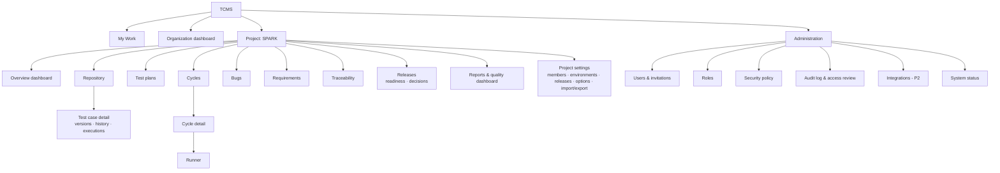

# 07 — UI/UX Specification

| Field | Value |
| --- | --- |
| Version | 1.0 · 2026-11-03 |
| Depends on | [02 Functional Spec](02-Functional-Specification.md), [06 API](06-API-Specification.md) |
| Implementation | React + Tailwind + shadcn/ui ([04 LLD §11](04-LLD.md)) |

Wireframes are low-fidelity ASCII: they fix **what is on the screen, where, and how it behaves**, not visual styling. Visual direction is in §6.

---

## 1. Design principles

1. **Operational efficiency over decoration.** Dense, scannable tables; no hero banners; whitespace serves grouping, not style.
2. **Stay in context.** Details open in a right-side panel over lists; full pages only for deep work (case editing, runner, RTM).
3. **One screen for execution.** The runner never navigates away to record, attach, or link a bug.
4. **Keyboard first, mouse friendly.** Every frequent action has a shortcut; shortcuts are discoverable (`?`).
5. **Truthful numbers.** Every percentage shows its counts; undefined rates show "—".
6. **Status is never colour alone.** Icon + label + colour.
7. **Predictable.** Same table, filter bar, side panel, badges and dialogs everywhere.

## 2. Information architecture



## 3. Application shell

```
┌──────────────────────────────────────────────────────────────────────────────────────────┐
│ [≡] TCMS   [SPARK ▾]   Repository › Web Application › Login     [/ Search…]  [🔔3] [SM▾] │
├───────────────┬──────────────────────────────────────────────────────────────────────────┤
│ ● My Work     │                                                                          │
│               │                       PAGE CONTENT                                       │
│ SPARK         │                                                                          │
│  ▸ Overview   │                                                                          │
│  ▸ Repository │                                                                          │
│  ▸ Plans      │                                                                          │
│  ▸ Cycles     │                                                                          │
│  ▸ Bugs       │                                                                          │
│  ▸ Requirements│                                                                         │
│  ▸ Traceability│                                                                         │
│  ▸ Releases   │                                                                          │
│  ▸ Reports    │                                                                          │
│  ▸ Settings   │                                                                          │
│               │                                                                          │
│ Organization  │                                                                          │
│  ▸ Dashboard  │                                                                          │
│  ▸ Admin*     │                                                                          │
│ [« collapse]  │                                                                          │
└───────────────┴──────────────────────────────────────────────────────────────────────────┘
* visible to Org Admins / users with any org.* permission
```

- **Project switcher** (`[SPARK ▾]`): searchable list of the user's projects, recent first; `G P` opens it.
- **Breadcrumbs** reflect the route; folder paths are clickable segments.
- **Global search** (`/`): command-palette style overlay (§4.3).
- **Sidebar** collapsible to icons (state remembered); items hidden when the user lacks `project.view`; Settings shown only with `project.configure` or `project.members.manage`.
- **Notifications** bell: dropdown with latest 20, "mark all read", link to item. Implementation (M7): bell left of the user menu with a red unread badge (accessible name "Notifications, n unread"); unread items in bold; opening one marks it read; export notifications download the file. Email settings in Your account › Notifications (mention emails, daily summary).
- **User menu**: profile, API tokens, sessions, MFA, theme (light/dark/system), keyboard shortcuts, sign out.

## 4. Global interaction patterns

### 4.1 Data tables

```
┌ Filter bar ───────────────────────────────────────────────────────────────────────────┐
│ [Saved view: My regression ▾] [Status: Failed, Blocked ×] [Assignee: me ×] [+ Filter]  │
│ [🔍 Search in list…]                                   [Columns ▾] [Export ▾] [⋯]       │
├───────────────────────────────────────────────────────────────────────────────────────┤
│ ☐ │ Key ▾        │ Title                          │ Priority │ Status    │ Assignee │…│
│ ☐ │ SPARK-TC-12  │ Login with valid credentials   │ ▲ High   │ ✖ Failed  │ Sana     │ │
│ ☐ │ SPARK-TC-13  │ Login with locked account      │ ■ Medium │ ✔ Passed  │ Bilal    │ │
├───────────────────────────────────────────────────────────────────────────────────────┤
│ 2 selected · Select all 342 matching   [Assign] [Tag] [Move] [More ▾]   « 1 2 3 … 7 » │
└───────────────────────────────────────────────────────────────────────────────────────┘
```

- Click row → open side panel; `Ctrl/Cmd+click` or middle-click → open full page in new tab.
- Column resize/reorder/visibility persisted per user per table.
- Bulk action bar appears on selection; "select all matching" switches the action to filter-based.
- Implementation (`DataTable`, used by every table): toolbar (context + actions on the left; result count, Clear filters and Columns on the right), sortable headers, a per-column filter row (text, select, or a date-range popover), and a footer with "Showing x–y of N", rows per page (10/25/50/100) and first/previous/next/last. Large lists (cases, activity, history) filter, sort and page on the server; small lists in the browser. Tables in the side panel use the dense variant, with less-used columns hidden until chosen in Columns.
- Sticky header; virtualized rows for > 200 rows per page.
- Inline edit (double-click cell) for priority, assignee, tags where permitted.
- Keyboard: `J/K` move row focus, `X` select, `Enter` open panel, `Esc` close.

### 4.2 Side panel

Right drawer 560–720 px (resizable), deep-linked via query param (`?case=SPARK-TC-12`). Header: key, title, status badge, actions menu, "Open full page", close. Tabs depend on entity. Navigating rows with `J/K` while the panel is open updates it.

### 4.3 Global search overlay

```
┌ Search ────────────────────────────────────────────────┐
│ 🔍 login timeout                       [This project ▾] │
├────────────────────────────────────────────────────────┤
│ TEST CASES                                             │
│   SPARK-TC-12  Login with valid credentials            │
│   SPARK-TC-40  Session timeout after inactivity        │
│ BUGS                                                   │
│   SPK-431      Dashboard load exceeds 3 s after login  │
│ REQUIREMENTS · CYCLES · PLANS · FOLDERS                │
│   … see all results →                                  │
├────────────────────────────────────────────────────────┤
│ ↑↓ navigate · Enter open · Ctrl+Enter new tab · Esc    │
└────────────────────────────────────────────────────────┘
```

Typing an exact key jumps straight to it on Enter. Also acts as command palette: `>` prefix lists actions ("> New test case", "> Go to cycle…").

Implementation (M6): the header button "Search or type > for actions" (`/`) opens the overlay. Results come from `GET /search`, grouped by type (cases, folders, plans, cycles, requirements, bugs); inside a project the current project is searched, elsewhere every project the user is a member of. An exact key is listed first. The `>` actions are Go to My Work / Repository / Plans / Cycles / Bugs / Requirements / Traceability / Activity / Projects and New test case.

### 4.3b Saved views (M6)

The case list, plans, cycles, cycle runs, bugs and requirements have a "Saved views" menu in the toolbar (the button reads "Saved views: <name>" when one is applied). It lists my views and shared views, and offers Save view… (name, "Share with the project" for users with cycle.manage, plan.manage or project.configure, "Open this list with this view"), Update, Rename and Delete (owner only). A view stores the list's filters, sort and the screen state (folder, search text). My default wins over the project default. Column visibility is not saved.

### 4.4 Forms and dialogs

- Labels above fields; required marked `*`; inline validation on blur and on submit; server errors mapped to fields from `errors[]`.
- Primary action bottom-right; `Ctrl+Enter` submits; `Esc` cancels (confirm if dirty).
- **ReasonDialog** for actions requiring a reason (block run, reopen cycle).
- **Conflict dialog** on `409 stale_row_version`: "Changed by X at T" + Reload / Compare.
- Destructive confirmations require typing the key for hard deletes and project archive.

### 4.5 Feedback

- Toasts for success (auto-dismiss 4 s) with "Undo" where reversible (e.g., unassign).
- Long operations (imports, large cycles, bulk > 200): toast with progress link; completion notification.
- Inline banners for state (closed cycle read-only, archived project, newer version available).

## 5. Screens

### 5.1 Login and MFA

```
┌──────────────────────────────┐
│           TCMS               │
│  Email    [               ]  │
│  Password [               ]  │
│  [ Sign in ]                 │
│  Forgot password?            │
└──────────────────────────────┘
        ↓ (MFA enrolled)
┌──────────────────────────────┐
│  Enter the 6-digit code      │
│  [ _ _ _ _ _ _ ]             │
│  [ Verify ]                  │
│  Use a recovery code         │
└──────────────────────────────┘
```

- Generic error text; lockout message per [02 §3.3](02-Functional-Specification.md).
- Code field auto-submits on 6 digits; paste supported.
- Forced MFA enrolment screen: QR code, manual secret, verify code, then show recovery codes with "Download" and "I've saved these" checkbox before continuing.
- Invitation acceptance: name, password (strength hint, list of rules), then MFA if required.

### 5.2 Organization dashboard

```
Organization · ACME Energy                                   [Date: last 30 days ▾]
┌ Projects ───────────────────────────────────────────────────────────────────────────┐
│ Project │ Active cycles │ Execution progress   │ Pass rate        │ Failed runs │ Bugs on failing runs │ Last activity │
│ SPARK   │ 2             │ ███████░░ 205/245    │ 180/205 (88%)    │ 20          │ 3                    │ 5 min ago     │
│ HELIOS  │ 1             │ ██░░░░░░░ 40/180     │ 38/40 (95%)      │ 2           │ 1                    │ 2 h ago       │
└─────────────────────────────────────────────────────────────────────────────────────┘
```

Row click → project overview. Visible projects limited to memberships unless Org Admin. Route `/org` (sidebar Organization › Dashboard). Numbers cover planned and active cycles; "Open crit/high" became failed runs and bugs on failing runs (ADR-023).

### 5.3 Project overview dashboard

```
SPARK · Overview                        [Release: SPARK v2.5 ▾] [Cycles: all ▾] [Env ▾]
┌ Readiness ──────────────┐ ┌ Execution ─────────────────┐ ┌ Bugs ───────────────────┐
│ ✖ Not ready  (2 of 4    │ │ Progress 205 of 245 (84%)  │ │ Linked 14                │
│   rules unmet)          │ │ Pass rate 180 of 205 (88%) │ │ On failing runs 3        │
│ [View readiness →]      │ │ ▇▇▇▇▇▇▇▇▇▇▇▇░░░ P F B S NR  │ │ [View bugs →]            │
└─────────────────────────┘ └────────────────────────────┘ └─────────────────────────┘
┌ Active cycles ─────────────────────────────────────────────────────────────────────┐
│ SPARK-CY-12 Regression Cycle 01 · QA · due Nov 10  ▇▇▇▇▇▇▇▇░░  205/245  ⚠ 3 retest │
│ SPARK-CY-13 Smoke – Staging     · Staging · due Nov 5 ▇▇▇▇▇▇▇▇▇▇ 40/40             │
└────────────────────────────────────────────────────────────────────────────────────┘
┌ Requirement coverage ─────┐ ┌ Team progress ────────────────────────────────────────┐
│ Covered 54 of 60 (90%)    │ │ Sana   ▇▇▇▇▇▇▇▇░ 48/55   F 4  B 1                     │
│ Verified 41 of 60 (68%)   │ │ Bilal  ▇▇▇▇▇░░░░ 30/52   F 2                          │
│ Top uncovered → list      │ │ Pool   ░░░░ 12 unassigned  [Assign →]                 │
└───────────────────────────┘ └───────────────────────────────────────────────────────┘
┌ Repository ─────────────────┐ ┌ Activity ───────────────────────────────────────────┐
│ 4,112 cases · 97% approved  │ │ Sana finalized SPARK-CY-12 / TC-1042 as Failed  2m  │
│ 38% automated               │ │ Sana linked SPK-431 to SPARK-TC-1042             9m  │
└─────────────────────────────┘ └─────────────────────────────────────────────────────┘
```

Each widget links to the detailed view with filters applied. This is also the **QA Manager dashboard** (§5.12 lists its full widget set). Implementation (M7): route `/p/:key` (the project home, `G O`); filters Release (default: the first active release), Environment and Tester, remembered per project in the browser; one request (`/dashboards/manager`) feeds every widget; the Status by cycle chart has a "View data" table. The Activity feed stays on its own page.

### 5.4 Test repository

```
Repository                                    [+ New case (C)] [+ Folder] [Import] [Export]
┌ Folders ───────────────────┐┌ Cases in "Login" (incl. subfolders) ─────────────────────┐
│ [🔍 filter folders]         ││ [Status ▾][Priority ▾][Type ▾][Tag ▾][Owner ▾][+]  🔍     │
│ ▾ Web Application    1,204  ││ ☐ Key          Title                    Pri  Status  Ver │
│   ▾ Authentication     86   ││ ☐ SPARK-TC-12  Login with valid creds   ▲Hi  ✔Appr   v4  │
│     ▸ Login            31   ││ ☐ SPARK-TC-13  Login – locked account   ■Me  ✎Draft  v2  │
│     ▸ Logout            9   ││ ☐ SPARK-TC-14  Login – wrong password   ■Me  ⏳Review v1  │
│     ▸ Password Reset   46   ││ …                                                        │
│   ▸ Dashboard         410   ││                                                          │
│   ▸ Reporting         708   ││ 31 cases                                     « 1 »        │
│ ▸ Backend Services    980   │└──────────────────────────────────────────────────────────┘
│ ▸ Data Integration    640   │   (row click → side panel: case detail §5.6)
│ ▸ AI/ML Features      220   │
│ [ ] Show archived           │
└─────────────────────────────┘
```

- Tree: drag folders to move/reorder (confirm when moving > 100 cases); drag cases onto a folder to move; right-click menu: new subfolder, rename, archive, delete, export folder, add folder to plan/cycle.
- Counts include descendants; selected folder highlighted; `←/→` collapse/expand.
- Toggle "include subfolders" in case list header.
- Bulk actions: Move, Tags, Priority, Type, Owner, Reviewer, Automation status, Add to plan, Add to cycle, Deprecate, Archive, Export.
- Empty folder state: "No cases yet — Create a case (C) or Import".

### 5.5 Test case creation and editing (full page)

```
SPARK › Repository › Web Application › Authentication › Login
New test case                                                     [Cancel] [Save (Ctrl+S)]
┌ Main ───────────────────────────────────────────────────────┐┌ Properties ─────────────────┐
│ Title *  [Login with valid credentials                    ] ││ Folder *   [Login ▾]         │
│ Format   (•) Steps  ( ) Text                                ││ Type *     [Functional ▾]    │
│ Description  [markdown ………………………………………………………… ]           ││ Technique  [Positive ▾]      │
│ Preconditions [markdown ………………………………………………………… ]          ││ Priority * [High ▾]          │
│ Test data     [markdown ………………………………………………………… ]          ││ Owner *    [Sana Malik ▾]    │
│                                                             ││ Reviewer   [Bilal Khan ▾]    │
│ Steps                                                       ││ Tags       [regression ×][+] │
│ ┌──┬──────────────────────────┬──────────────────────────┐  ││ Automation [Manual ▾]        │
│ │ #│ Action *                 │ Expected result          │  ││ Est. min   [5]               │
│ ├──┼──────────────────────────┼──────────────────────────┤  ││ Requirements [+ Link]        │
│ │ 1│ Open the login page      │ Form is displayed        │⋮ ││  SPARK-R-12 Sign in ×        │
│ │ 2│ Enter valid email/pass…  │ Dashboard within 3 s     │⋮ ││ Attachments [Drop files]     │
│ │ +│ (Enter = new step)       │                          │  │└──────────────────────────────┘
│ └──┴──────────────────────────┴──────────────────────────┘  │
│ [+ Data column] (shows per-step "Data" field)               │
│ Expected overall result [markdown]                          │
│ Postconditions [markdown]                                   │
│ Change note (on edit) [                         ]           │
└─────────────────────────────────────────────────────────────┘
```

- Step grid: `Enter` in Expected adds a new step below; `Tab`/`Shift+Tab` move between cells; `Alt+↑/↓` reorder; `Ctrl+D` duplicate step; `Ctrl+Backspace` delete step (undoable); drag handle; paste multi-line text from Excel splits into steps (tab-separated → action/expected).
- Each cell is a compact Markdown editor (preview on blur).
- "Save & new" (`Ctrl+Shift+S`) keeps folder and properties for rapid authoring.
- Editing an existing case shows a banner when approval is on: "Saving creates v5. Cycles keep using approved v4 until v5 is approved."
- Unsaved-changes guard on navigation. Autosave of an unsaved draft to local storage every 10 s (restored on reopen).

### 5.6 Test case detail and version history

Side panel or full page with tabs:

```
SPARK-TC-12 · Login with valid credentials            ✔ Approved · v4   [Edit] [Run in…▾] [⋯]
[Details] [Versions (4)] [Executions (17)] [Requirements (2)] [Bugs (1)] [History] [Comments (3)]

Details: properties summary row + preconditions, steps table (read view), attachments.

Versions:
┌──────┬────────────┬───────────────┬──────────────────────┬────────────────────┐
│ Ver  │ Date       │ Author        │ Note                 │ Approval           │
│ v4 ● │ Nov 2      │ Sana Malik    │ Clarified timing     │ Approved · Bilal   │
│ v3   │ Oct 20     │ Sana Malik    │                      │ Approved · Bilal   │
│ v2   │ Oct 3      │ Ayesha R.     │ Added lockout step   │ Auto               │
└──────┴────────────┴───────────────┴──────────────────────┴────────────────────┘
[Compare v3 ↔ v4]  [Restore v3]

Compare view (side by side): changed fields highlighted; steps aligned; added (green +),
removed (red −, strike), changed (yellow, inline word diff); "show unchanged" toggle.

Executions: table — cycle, release, env, version, status, executed by, date, bugs.
```

Review mode (when `in_review` and user can approve): top bar `[Approve] [Return…]`, diff against approved version shown by default, per-step comment threads.

### 5.7 Test plan creation and detail

```
New test plan                                                          [Cancel] [Create]
Name *          [SPARK v2.5 Regression                   ]
Type *          [Regression ▾]     Release [SPARK v2.5 ▾]    Owner [Ayesha ▾]
Dates           [2026-11-03] → [2026-11-14]                 Environments [QA ×][Staging ×]
Objectives      [markdown]
Scope           In scope [markdown]          Out of scope [markdown]
Entry criteria  [markdown]
Exit criteria   Rules:  [Execution progress ≥ 100%] [No failed runs] [+ Rule ▾]
                Notes [markdown]
Risks           ┌ Description ─────────────┬ Impact ┬ Mitigation ─────────────┐ [+ Risk]
Acceptance crit [markdown]
QA members      [Sana ×][Bilal ×][+]
```

Plan detail tabs: **Overview** (fields + readiness of its rules), **Cases** (table with "Add cases" dialog: tabs Folder / Tag / Saved view / Search; shows "will add N, skip M (archived/deprecated/unapproved)"), **Requirements**, **Cycles** (list + `[Create cycle]`), **History**.

### 5.8 Cycle creation and cycle detail

Creation dialog (stepped, one screen):

```
New cycle                                                                  [Cancel] [Create]
1 Basics    Name * [Regression Cycle 01]  Release [SPARK v2.5 ▾]  Environment * [QA ▾]
            Build [2.5.0-rc1]  Start [2026-11-03]  Due [2026-11-10]
2 Cases     (•) From plan [SPARK-PL-3 ▾]  filter: [Priority ▾][Tag ▾][Folder ▾]
            ( ) From repository: [Select folders/tags/cases…]
            → 250 cases will be added · 5 skipped [details]
3 Assign    Default assignee [— leave in pool —▾]   (assign later in cycle)
```

Cycle detail:

```
SPARK-CY-12 · Regression Cycle 01   ● Active · QA · build 2.5.0-rc1 · due Nov 10
[▶ Start testing] [Assign ▾] [+ Add cases] [⋯ Close / Clone / Sync from plan / Export]
┌ Progress ───────────────────────────────────────────────────────────────────────────┐
│ ▇▇▇▇▇▇▇▇▇▇▇▇▇▇▇▇░░░░  Executed 205 of 245 (84%) · Passed 180 of 205 (88%)           │
│ ✔ 180  ✖ 20  ⛔ 5  ⤼ 4  ◐ 6  ○ 30  (N/A 5)              ⚠ 3 need retest            │
└──────────────────────────────────────────────────────────────────────────────────────┘
[By assignee] [By folder]  ← toggle grouping of the table below
┌ Runs ─────────────────────────────────────────────────────────────────────────────────┐
│ [Status ▾][Assignee ▾][Folder ▾][Priority ▾][Needs retest][🔍]                         │
│ ☐ # │ Case          │ Title                       │ Ver │ Assignee │ Status    │ Bugs    │
│ ☐ 1 │ SPARK-TC-12   │ Login with valid creds      │ v3↑ │ Sana     │ ✖ Failed  │ SPK-431 ⟳│
│ ☐ 2 │ SPARK-TC-13   │ Login – locked account      │ v2  │ Sana     │ ✔ Passed  │         │
│ ☐ 3 │ SPARK-TC-40   │ Session timeout             │ v1  │ — pool — │ ○ Not run │         │
└───────────────────────────────────────────────────────────────────────────────────────┘
```

- `v3↑` indicates a newer version exists (tooltip with action availability).
- `⟳` marks needs retest.
- "Start testing" opens the runner with queue = my not-finalized runs (or all if none assigned).
- Closed cycle: read-only banner with "Reopen" (permission) and closed by/at.

### 5.9 Test execution interface (runner)

Full-width page; the sidebar auto-collapses.

```
← SPARK-CY-12 Regression Cycle 01   Run 7 of 48 (my queue)   [◀ Prev] [Next ▶ (Shift+N)]   ⏱ 04:12
┌ Queue ──────────────┐┌ SPARK-TC-12 · Login with valid credentials   v3 (v4 available ⓘ)   ▲ High ┐
│ [Mine ▾][Not done ▾]││ Preconditions: User qa.user@acme.test exists and is active   [▾ test data]│
│ ✔ TC-10 Logout       ││──────────────────────────────────────────────────────────────────────────│
│ ✖ TC-11 Reset pwd    ││ #  Action                       Expected                 Result            │
│ ▶ TC-12 Login valid  ││ 1  Open the login page          Form is displayed        [✔ P][✖ F][⛔ B][⤼ S]│
│ ○ TC-13 Locked acct  ││                                                          ✔ Passed          │
│ ○ TC-14 Wrong pwd    ││ 2  Enter valid email/password,  Dashboard loads within   [✔][✖][⛔][⤼]       │
│ …                    ││    press Sign in                3 s                      ✖ Failed           │
│                      ││    Actual result * [Dashboard took 9 s; spinner shown          ]          │
│                      ││    📎 screenshot-1.png  [+ attach / paste]   [Link bug (D)]           │
│                      ││    🐞 SPK-431 ⋯                                                          │
│                      ││ 3  Check the header             User name shown           ○ Not run      │
│                      ││──────────────────────────────────────────────────────────────────────────│
│                      ││ Comment [markdown]                         Build [2.5.0-rc1]              │
│                      ││ [Pass all remaining]  [Block run…] [Skip…] [N/A…]     [Finish run (Ctrl+⏎)]│
│                      ││ Result preview: ✖ Failed                                                 │
└──────────────────────┘└──────────────────────────────────────────────────────────────────────────┘
History: attempt 1 ✖ Failed · Sana · Nov 3 10:04  [view]     Bugs: SPK-431  [Copy bug details]
```

Behaviour:

- Opening a run with no draft shows `[Start (Space)]`; starting creates the draft. If the run has a final result: `[Retest]` and `[Correct result…]` (permission).
- Focused step row highlighted; `P/F/B/S` set status and move focus to the next step (except `F`, which focuses Actual result).
- Result preview updates live from BR-09; Finish disabled with explanation when incomplete ("2 steps not recorded — record them or Block/Skip/N/A the run").
- Save status indicator per step (✓ saved, ↻ saving, ⚠ not saved – retrying).
- Link bug (`D`) opens the Link bug dialog for the current step (§8.2 of the functional spec); saving shows the chip on the step and returns to the runner. "Copy bug details" copies a ready-to-paste report for the tracker. When the project requires a bug link on failures, Finish opens the dialog and finishes once the bug is linked.
- After finishing: toast "SPARK-TC-12 Failed · Next: SPARK-TC-13" and auto-advance after 1 s (setting; default on).
- Bug chips appear on each step, on the attempt line and in History; a passing retest clears ⟳ and the chips stay (BR-22 retired).
- Newer version banner: if no attempt yet and permitted → `[Update to v4]`.
- Timer: elapsed since start (pause button); used as duration on finish (editable).
- Text-format cases show the text body and a status selector instead of the step grid.
- Responsive ≥ 768 px: queue collapses into a dropdown.

### 5.10 Bugs (ADR-023)

Bugs are reported and fixed in the team's tracker; Assay shows the links.

- **Bugs list** (`/p/:key/bugs`, `G D`): one row per reference: Bug (reference, ↗ open in tracker, title), Cases, Runs, Failing now (with ⟳ when runs need retest), Cycles, Last linked, `[Ready for retest]` (cycle.manage). Filter row: text (reference or title); toolbar checkbox "Linked to failing runs". Clicking a row opens a dialog listing every link (case, cycle · attempt (status) · step, run status, Open run).
- **Bug chip** (everywhere): bug icon + reference (+ title where there is room), fail tone; a link to the tracker URL when there is one (`target=_blank`, `rel=noopener noreferrer`, http(s) only). The `⋯` part opens: Open in <tracker>, Copy reference, Ready for retest…, Edit link…, Remove link… (by permission).
- **Link bug dialog**: Bug reference (required; recent references of the cycle as quick picks), Link (placeholder = the URL the project template would build; empty uses it), Title. Errors inline.
- **Ready for retest dialog**: "n of m linked runs will be flagged ⟳ for retest" (dry run), `[Flag for retest]`.
- Project settings › Options › **Bug tracker**: tracker name ("Open in Jira") and bug address with `{ref}`.

### 5.11 Requirements and traceability matrix (ADR-024)

Requirements are written in the team's tool; Assay shows references to them (`SPK-120 ↗`) and the cases that verify them. There is no hierarchy: lists are flat, in natural order of the reference (SPK-2 before SPK-10).

- **Requirements list** (`/p/:key/requirements`, `G Q`): Requirement (reference ↗, title), Cases, Status (all cycles), Updated; filter on reference or title and on "Linked to cases / Not linked"; "Show archived"; saved views. `[Add requirements]` (requirement.manage) opens "Paste many": one reference per line, optionally `reference<TAB>title<TAB>url`, up to 500. A row opens a dialog to edit the link and title, archive or restore, and link or unlink cases.
- **Case detail › Requirements tab**: chips of the linked references, `[Link requirement]` (requirement.link) accepts known or new references.
- **Plan detail › Requirements tab**: references in the plan's scope with their status in the plan's release; add/remove with plan.manage.
- **Repository bulk action** "Link to requirement": links the selected (or all matching) cases to one reference. The repository filter has a Requirement input (a reference, or "has requirements" yes/no).
- Requirement chip: reference + ↗ to the URL (own link, or the project's requirement address, which falls back to the bug address), title where there is room.

```
Traceability                 [Release: SPARK v2.5 ▾] [Status in release ▾] [☐ Uncovered only] [Reference or title]
Coverage 54 of 60 (90%) · Verified 41 of 60 (68%) · Failed 4 · Blocked 1 · Not run 8 · Not covered 6
┌────────────────────────────────────┬───────┬───────────────────┬────────────────────────────┬──────────┐
│ Requirement                        │ Cases │ Status in release │ Latest results             │ Bugs     │
├────────────────────────────────────┼───────┼───────────────────┼────────────────────────────┼──────────┤
│ ▾ SPK-12 ↗ Sign in with SSO        │   3   │ ✖ Failed          │ TC-12 ✖ · TC-50 ○ · TC-51 ✔ │ SPK-431  │
│     SPARK-TC-12 Login with SSO     │       │                   │ ✖ C-4 · 3 Nov · Sana · Details│        │
│ ▸ SPK-13 ↗ Password reset          │   4   │ ✔ Passed          │ ✔✔✔✔                       │          │
│ ▸ SPK-20 ↗ Energy dashboard KPIs   │   0   │ ◌ Not covered     │ [Link cases]               │          │
└────────────────────────────────────┴───────┴───────────────────┴────────────────────────────┴──────────┘
```

- Release "All cycles" shows every non-archived reference; a release shows references a plan of the release lists or whose cases ran in it.
- Expanding a requirement shows case rows with the latest result (cycle, date, executed by) and a Details link to the run.
- Bugs column: bug chips from the release's runs of the linked cases, plus links made directly on the case.
- "Link cases" (requirement.link) opens the case picker.
- Export of the matrix comes with M8.

### 5.12 QA dashboards

- **QA Manager dashboard** = Project overview (§5.3) with the complete widget set from [02 §11.3](02-Functional-Specification.md): repository, active cycles, execution summary, status breakdown per cycle (stacked bars), bugs (linked, on failing runs, failures without a bug; ADR-023), coverage with the top uncovered references, regression status, readiness, team progress.
- **Quality dashboard** (Reports › Quality, `/p/:key/reports`): trend charts (execution and pass rate per day; P/F/B per day; bug links per day; bugs by module), release-wise quality table for the last 6 releases, automation coverage; `[Refresh]` recomputes today's snapshot. Every chart has a "View data" table toggle.
- **Reports** (tabs next to Quality): the six reports of 02 §11.5 as paginated tables with their filters and `[CSV]` `[Excel]` export (`data.export`); a large export shows "Preparing the export…" and then a Download link.
- Chart rules: counts on hover and in the data table; percentages labelled with "x of y"; colours from status tokens; no 3D, no pie charts for > 5 categories.

### 5.13 Administration and integrations

```
Administration
[Users] [Invitations] [Roles] [Security] [Audit log] [Access review] [Integrations (P2)] [System]

Users: table — name, email, status, org admin, MFA (✔/✖), projects (n), last sign-in;
       actions: invite, deactivate/reactivate, reset MFA, revoke sessions, toggle org admin.
Roles: read-only permission matrix (MVP); P2 editor.
Security: MFA required for all, session idle/absolute timeouts, attachment limits, audit retention.
Audit log: filterable table, CSV export, event detail drawer (changes old → new).
Access review: [Export XLSX] [Export CSV] + preview table.
Integrations (P2): Jira connections — status, last sync, errors, [Test], [Configure mappings].
System: version, migration head, job queue (queued, running, dead) with retry/discard, storage usage.
```

As built (M8b): the sidebar has one **Administration** link (`/admin`, opens the first tab the user may see); the tab bar is a `navigation "Administration"` above each page and shows tabs by permission (Users, Invitations, Roles: `org.users.manage`; Security, System: `org.manage`; Audit log, Access review: `org.audit.view`). Integrations (P2) is not shown.

- **Users** (`/admin/users`): Name (You, Org admin tags), Email, Status, Two-step, Projects (one `KEY Role` tag per project), Last sign-in, and an actions menu per row: Make/Remove organization admin, Reset two-step verification… (reason prompt), Sign out everywhere, Deactivate…/Reactivate. Blocked actions stay in the menu, disabled, with the reason under the label ("You cannot deactivate yourself", "The last organization administrator", "Not set up"). Invite someone opens Invitations.
- **Roles** (`/admin/roles`): table `Role permissions`, one row per project permission (plain label and code) and one column per system role; a note on what organization administrators can do. The unused bug-status permissions (ADR-023) are not listed.
- **Audit log** (`/admin/audit`): server-side table `Audit events` (When, Project, By, Event, Type, Action) with filters date range, project, person, text and record type; Export CSV uses the current filters. A row opens a dialog (the "drawer") with When, By, Action, Record, Project, a `Changed fields` table (Field, Before, After) and the request context. The project audit log (`/p/{key}/audit`, QA Managers) is the same screen without the Project column, opened from **Audit log** on the project's Activity page.
- **Access review** (`/admin/access-review`): table with Person, Scope (Organization or the project), Role, Two-step, Granted by, Granted, Last sign-in; Export XLSX and Export CSV.
- **System** (`/admin/system`): Version (application, environment, schema revision, audit retention), Health (database, schema, file storage), Files (attachment count and size), Background jobs (counts by status, oldest waiting job, last finished job) and a `Failed jobs` table (Job, Status: Failed or Gave up, Attempts, Last error, Stopped, Retry). The page refreshes every 30 s. Discard is not offered: failed jobs are deleted after 90 days (docs/05 §9).

Project settings: General (name, description, key read-only), Options (approval, self-approval, only-assignee-executes, module depth, require a bug link for failures, bug tracker name and address, attachment limit), Members (table + add), Environments, Releases, Tags, Import/Export, Danger zone (archive project).

### 5.14 My Work

```
My Work                                                            [All projects ▾]
┌ To execute (52) ─────────────────────────────────────────────────────────────────────┐
│ SPARK-CY-12 Regression Cycle 01 · due Nov 10   ○ 30 not run · ◐ 2 in progress · ⟳ 3  │ [Continue ▶]
│ HELIOS-CY-4 Smoke                · due Nov 5    ○ 20                                  │ [Start ▶]
└──────────────────────────────────────────────────────────────────────────────────────┘
┌ Failed, blocked or to retest (3) ────────────────────────────────────────────────────┐
│ SPARK-TC-1042 Dashboard totals      SPARK-CY-12   ⟳ Needs retest  ✖ Failed           │
└──────────────────────────────────────────────────────────────────────────────────────┘
┌ Awaiting my review (6) ─┐ ┌ Today ──────────────────┐ ┌ My week ───────────────────┐
│ TC-14 Login wrong pwd   │ │ Executed 9 · P 8 F 1    │ │ Executed 61 · P 52 F 7 B 2 │
│                         │ │                         │ │ Bugs you linked: 4         │
└─────────────────────────┘ └─────────────────────────┘ └────────────────────────────┘
┌ Upcoming (next 14 days) ─────────────────────────────────────────────────────────────┐
```

M7 adds the QA Engineer widgets of 02 §11.3: failed and blocked runs and runs flagged for retest (flagged first, then the most recently changed; 20 at most), today, bugs linked this week, and cycles starting in the next 14 days.

### 5.15 Release and readiness

Release page: header (name, status, dates, `[Change status]`), tabs **Readiness**, **Plans**, **Cycles**, **Bugs**, **Decisions**.

```
Readiness · SPARK v2.5                                             ✖ Not ready
┌ Rule ──────────────────────────────┬ Threshold ┬ Actual                 ┬ Met ┐
│ Execution progress                  │ ≥ 100%    │ 205 of 245 (84%)       │ ✖   │
│ No failed runs                      │ = 0       │ 0                      │ ✔   │
│ Pass rate of applicable             │ ≥ 95%     │ 180 of 245 (73%)       │ ✖   │
│ Requirement coverage                │ ≥ 90%     │ 54 of 60 (90%)         │ ✔   │
└─────────────────────────────────────┴───────────┴────────────────────────┴─────┘
[Record decision…]  → dialog: (•) Go ( ) Go with risks ( ) No-go · Comment * · Risks (if go with risks)
Decisions: timeline with snapshot viewer.
```

Implementation (M7, ADR-025): sidebar **Releases** (`/p/:key/releases`) lists releases with status, target date, execution bar, readiness (planned and active releases) and the latest decision; creating and editing releases stays in Settings. The release page shows each rule with the plan it comes from ("Default rule" when no plan has rules), the per-plan Ready badges, the release's execution and coverage, and `[Record decision…]` for `release.manage`. The plan Overview's Exit criteria card shows the same rule table for the plan.

### 5.16 Import wizard

```
Import test cases                                             Step 2 of 4: Map columns
1 Upload  ✔   2 Map  ●   3 Validate   4 Commit
Sheet [Regression ▾]   Rows: 4,210   Steps layout (•) one row per step ( ) all steps in one cell
┌ File column ──────────┬ Sample                         ┬ Maps to ───────────────┐
│ ID                    │ SPK-001                        │ [Key (update) ▾]        │
│ Summary               │ Login with valid credentials   │ [Title ▾]               │
│ Module                │ Web/Auth/Login                 │ [Folder path ▾]         │
│ Step                  │ Open the login page            │ [Step action ▾]         │
│ Expected              │ Form displayed                 │ [Step expected ▾]       │
│ Prio                  │ P1                             │ [Priority ▾] values: P1→High, P2→Medium… │
└───────────────────────┴────────────────────────────────┴─────────────────────────┘
[Save mapping as template]                                        [Back] [Validate →]
Validate: counts (create 3,980 · update 0 · errors 12) + error table (row, column, message) + [Download errors]
Commit: progress bar → report link.
```

As built (M8a, route `/p/{key}/import?entity=test_case|requirement&transfer={id}`):

- **Entry points:** Import and Export buttons in the repository header; an Import link and an Export button on the Requirements page; Export in the case bulk bar (selected cases); Export on the Bugs page (bug-links report).
- **1 Upload:** drop zone or file picker (`File to import`), CSV or XLSX up to 20 MB. A saved template can be chosen here.
- **2 Map:** table `Column mapping` with one select per column (`Field for column {header}`), the first sample values, and per-value selects for enum fields when the column has 30 distinct values or fewer. Options: target folder, mode (update or create / create only), steps layout. "Save mapping as template" names and stores the mapping; an existing name is replaced.
- **3 Validate:** a status line while the dry run runs, then `Validation counts` (Create · Update · Unchanged · Errors · New folders or Links to add), the list of folders to create, the `Import errors` table (row, column, message; first 1,000) with Download errors (CSV), and warnings. The Import button (`Import N cases`) stays disabled while errors exist until "Skip rows with errors" is checked.
- **4 Import:** a status line ("You can leave this page; the bell tells you when it is done"), then the result counts, Download the import report, Open the repository (or Requirements) and Import another file. Finishing refreshes the cached repository and requirement lists.
- The `transfer` search parameter reopens a running or finished import, so the `import.finished` notification links straight back to the result.

## 6. Visual design system

### 6.1 Direction

Neutral, calm, high-contrast enterprise UI. Inter (UI) and JetBrains Mono (keys, code). Logo, icons and favicon come from [docs/brand](brand/README.md); `docs/brand` is the only source, and `make brand` copies the served files into `frontend/public` (`make brand-check` fails CI on drift).

| Place | Asset |
| --- | --- |
| Sign-in, MFA, reset and invitation screens (light) | `assay-logo.svg`, 40 px tall |
| Sidebar (Night background) | `assay-logo-on-dark.svg`, 28 px; collapsed: `assay-mark-on-dark.svg` |
| Browser tab, bookmarks, home screen | `favicon.ico`, `favicon.svg`, `png/assay-app-icon-180.png` (Apple touch), `192`/`512` PNGs in the web manifest; theme colour Assay Indigo `#4F46E5` |
| HTML emails | `png/assay-logo-64h.png` shown at 32 px (email clients often block SVG), loaded from `TCMS_BASE_URL/brand/` |

Logos are loaded as images, never inlined (the SVGs reuse mask ids), with the product name as alt text. Respect the clear-space and minimum-size rules in docs/brand/README.md. Base font 14 px, tables 13 px, line-height 1.45. Light and dark themes via CSS variables. 4 px spacing grid. Radius 6 px (controls), 8 px (cards). Minimal shadows (panels only).

### 6.2 Status tokens (single source: `StatusBadge`)

| Status | Icon | Label | Tokens (text · background · border · bar) |
| --- | --- | --- | --- |
| passed | ✔ check-circle | Passed | `--status-pass-*` #166534 · #DCFCE7 · #BBF7D0 · #16A34A |
| failed | ✖ x-circle | Failed | `--status-fail-*` #B91C1C · #FEE2E2 · #FECACA · #DC2626 |
| blocked | ⛔ octagon | Blocked | `--status-blocked-*` #92400E · #FEF3C7 · #FDE68A · #D97706 |
| skipped | ⤼ skip-forward | Skipped | `--status-skip-*` #475569 · #F1F5F9 · #E2E8F0 · #94A3B8 |
| not_applicable | ⊘ slash-circle | N/A | `--status-na-*` #556070 · #F8FAFC · #E2E8F0 |
| in_progress | ◐ half-circle | In progress | `--status-progress-*` #075985 · #E0F2FE · #BAE6FD · #0284C7 |
| not_run | ○ circle | Not run | `--status-notrun-*` #475569 · #FFFFFF · #CBD5E1 (outline) |
| needs_retest | ⟳ rotate | Needs retest | `--status-retest-*` #5B21B6 · #EDE9FE · #DDD6FE · #7C3AED |

Values come from `docs/design/README.md`; icons from this table (blocked uses the octagon, never the N/A slash-circle that some design mock-ups show). Light theme only in the MVP; the theme control is not rendered until dark tokens exist.

Case status: draft (pencil, slate), in_review (hourglass, blue), approved (check, green), deprecated (archive-x, amber), archived (archive, slate). Defect statuses grouped by category colour: new (open, reopened – red), triage (triaged, assigned – amber), work (in_progress, fixed – blue), verify (ready_for_retest – violet), done (verified, closed – green), parked (deferred – slate), invalid (rejected, duplicate, cannot_reproduce – slate). Priority/severity: critical ⬆⬆ red, high ▲ orange, medium ■ slate, low ▼ blue-gray.

All colour pairs meet 4.5:1 contrast for text, 3:1 for icons.

### 6.3 Core components

AppShell, Sidebar, Breadcrumbs, ProjectSwitcher, CommandPalette, DataTable, FilterBar, SavedViewMenu, BulkActionBar, SidePanel, Tabs, StatusBadge, PriorityIcon, ProgressBar, Metric, MarkdownEditor/View, StepGrid (edit), StepRunner (execute), DiffView, FolderTree, UserPicker, TagInput, EntityPicker, DateRangePicker, ReasonDialog, ConfirmDialog, ConflictDialog, Toast, EmptyState, ErrorState, Skeleton, FileDropzone, AttachmentList, CommentThread, ActivityTimeline, ChartCard.

## 7. States

| State | Pattern |
| --- | --- |
| Loading | Skeleton rows/cards matching layout; no spinners for < 300 ms |
| Empty | Icon, one-line explanation, primary action (e.g. "No cycles yet — Create cycle") |
| Error (load) | Inline ErrorState with message, request ID, Retry |
| Permission hidden | Actions the user cannot perform are hidden in menus; disabled with tooltip where their absence would confuse (e.g. Approve on own case: "You can't approve your own version") |
| Read-only contexts | Banner (closed cycle, archived project/case, Jira-owned field with "Owned by Jira") |
| Offline/failed save | Per-field indicator + retry; page-level banner if API unreachable |

## 8. Accessibility (WCAG 2.2 AA)

- Semantic landmarks; skip-to-content link; visible focus rings (2 px, high contrast).
- All interactive elements reachable by keyboard; focus trapped in dialogs/panels and restored on close.
- Tables use proper header associations; sortable headers expose `aria-sort`.
- Status badges include text; progress bars have `aria-label` with counts ("Passed 180, Failed 20, …").
- Live regions announce save status and toasts politely.
- Minimum target size 24 × 24 px; runner status buttons 32 px.
- Respects `prefers-reduced-motion` and OS dark mode.

## 9. Responsive behaviour

| Width | Behaviour |
| --- | --- |
| ≥ 1440 | Default layout; side panel 720 px |
| 1280–1439 | Side panel 560 px; repository tree 260 px |
| 1024–1279 | Sidebar collapsed to icons; side panel overlays |
| 768–1023 | Tables show priority columns only; runner queue in dropdown; editing supported |
| < 768 | Read-only dashboards, bug lists, My Work list; editing and runner show "Use a larger screen" with read view |

## 10. Keyboard shortcuts

| Scope | Keys | Action |
| --- | --- | --- |
| Global | `/` | Search / command palette |
| Global | `?` | Shortcut help |
| Global | `G` then `W/R/C/D/Q/T/O` | Go to My Work / Repository / Cycles / Bugs / Requirements / Traceability / Overview |
| Global | `G P` | Project switcher |
| Lists | `J/K`, `X`, `Enter`, `Esc` | Move, select, open, close panel |
| Repository | `C` | New case in current folder |
| Repository | `F` | New folder |
| Repository tree | `↑/↓`, `←/→`, `Enter`, `Shift+F10`, `Alt+↑/↓` | Move, collapse/expand, select, folder actions menu, reorder (the tree is one tab stop) |
| Case editor | `Ctrl+S`, `Ctrl+Shift+S` | Save, save & new |
| Case editor | `Enter` (in expected), `Alt+↑/↓`, `Ctrl+D`, `Ctrl+Backspace` | New step, reorder, duplicate, delete |
| Runner | `Space` | Start attempt |
| Runner | `P/F/B/S` | Set step status |
| Runner | `↑/↓` or `K/J` | Previous/next step |
| Runner | `D` | Link a bug to the current step |
| Runner | `A` | Attach file to current step |
| Runner | `Ctrl+Enter` | Finish run |
| Runner | `Shift+N`, `Shift+P` | Next / previous run |
