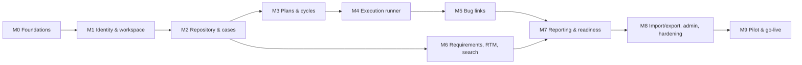

# 09 — Implementation Roadmap

| Field | Value |
| --- | --- |
| Version | 1.0 · 2026-11-03 |
| Depends on | [01 PRD](01-PRD.md), [10 Backlog](10-Backlog.md) |
| Team assumption | Claude Code generates code; 1 FE + 1 BE developer review, test and steer; QA Manager available for reviews and pilot |

Durations are indicative (working weeks, with Claude Code doing most implementation and the two developers reviewing). Each milestone ends with a demo, its exit criteria met, and CI green. Milestones are built strictly in order unless marked parallel.

---

## 1. Phase overview

| Phase | Goal | Gate to exit |
| --- | --- | --- |
| **MVP** (M0–M9, ~22 weeks) | Manual testing lifecycle end to end with trustworthy results and audit | SPARK runs a full regression cycle (≥ 250 cases, ≥ 3 testers, failures linked to bugs and retested, readiness decision recorded) entirely in TCMS; AC-PRD-01…09 |
| **Phase 2** (P2.1–P2.8, ~16 weeks) | Connect Jira and CI; reuse; SSO; advanced reporting | Jira-created defects and CI results live for SPARK for 4 weeks without manual reconciliation |
| **Phase 3** | Intelligence and breadth | Per-feature success measures |

## 2. MVP milestones

M6 can start in parallel with M4/M5 once M2 is done (separate module, different screens).

### M0 — Foundations (2 weeks)

| | |
| --- | --- |
| Scope | Repository layout ([04 LLD §1](04-LLD.md)); Docker Compose (db, minio, mailpit, api, worker, web); Makefile; CI pipeline with all gates stubbed; core primitives (config, db session, UoW, errors → problem+json, AccessContext, permission registry, ids, clock, pagination/filter/sort helpers); Alembic baseline with **all MVP tables, enums, triggers, roles** ([05 Database](05-Database-Design.md)); job queue + worker loop; audit recorder; attachment service skeleton; health endpoints; frontend shell (Vite, router, Tailwind, shadcn, API client generation, AppShell placeholder); seed command skeleton |
| Deliverables | Running stack with `make up`; empty app shell; CI green |
| Acceptance | `make up && make migrate && make seed` works on a clean machine in < 10 min; `alembic check` clean; the migrated schema matches `docs/schema/01_baseline.sql` (schema diff) and `docs/schema/99_verify.sql` passes as `tcms_app` in CI; problem+json for unknown route; job runs and retries in a test |
| Dependencies | None |

### M1 — Identity, access and workspace (2.5 weeks)

| | |
| --- | --- |
| Scope | E02, E03, E15 (audit write + record history; user administration API of US-164, UI in M8), minimal Administration › Invitations and Security policy screens: login, MFA (TOTP, recovery), lockout, rate limiting, password reset, invitations, sessions, CSRF, API tokens, roles/permissions seeding and resolution, org settings, projects, members, environments, releases, project activity feed; frontend: auth screens, shell with project switcher, project settings pages, profile/tokens |
| Deliverables | Users can be invited, sign in with MFA, create SPARK, add members |
| Acceptance | TCMS-001…014, 020…025a pass; authz matrix framework in place and enforced for all M1 routes |
| Dependencies | M0 |

### M2 — Repository and test cases (3 weeks)

| | |
| --- | --- |
| Scope | E04, E05, E06: folders (tree, move, counts), case CRUD with steps/text formats, versioning, compare, restore, review workflow, statuses, tags, related links, attachments (cases and steps), comments, bulk operations, case history; frontend: repository screen, case editor (step grid, keyboard), case detail with versions/compare/review |
| Deliverables | QA can build and review the repository |
| Acceptance | TCMS-030…047 pass; editor keyboard flow (TCMS-046) |
| Dependencies | M1 |

### M3 — Plans and cycles (2 weeks)

| | |
| --- | --- |
| Scope | E07, E08: plans (all fields, case selection, requirements link placeholder until M6, clone), cycles (create from plan/repository, version pinning, background creation, add/remove runs, assignment, claim, reorder, close/reopen/clone/archive, sync from plan, update-versions, replace run), cycle detail screen with progress |
| Deliverables | Leads can plan and assign a regression cycle |
| Acceptance | TCMS-025b, 050…060 pass; BR-03/04/05/11/12/31 tests |
| Dependencies | M2 |

### M4 — Execution runner (3 weeks)

| | |
| --- | --- |
| Scope | E09: attempts (start, record steps, finalize with roll-up, discard, take-over), retest, correction, text-format execution, evidence (paste/attach), needs-retest display, runner UI with queue/keyboard/auto-advance/save indicator, My Work |
| Deliverables | Testers can execute a cycle |
| Acceptance | TCMS-070…090 pass; roll-up matrix (TCMS-071) exhaustive; P2 perf scenario run on interim large seed: step save p95 < 200 ms |
| Dependencies | M3 |

### M5 — Bug links (1 week; re-scoped by ADR-023)

| Item | Content |
| --- | --- |
| Goal | Failures are connected to the bugs the team logs in its own tracker |
| Scope | E10: bug links on steps, attempts and cases; tracker name and URL template; Copy bug details; Bugs list; Ready for retest (BR-21); "failed result needs a bug link" option; `max_failed` readiness rule replaces `max_open_defects` |
| Deliverables | Bug chips in runner, run history, cycle runs and case; project Bugs page |
| Acceptance | TCMS-100…107 pass |
| Depends on | M4 |

### M6 — Requirement references, traceability and search (re-scoped by ADR-024)

| | |
| --- | --- |
| Scope | E11: requirement references (paste many, URL template), links to cases and plans, coverage per release, traceability matrix; E12: global search, command palette, saved views (incl. plan Add cases), requirement filters in the repository |
| Deliverables | PMs can reference their tool's requirements and see coverage |
| Acceptance | TCMS-110…112, 118…120 pass; coverage property test |
| Dependencies | M4 (results), M5 (bug links on the matrix) |

### M7 — Reporting and readiness (2.5 weeks)

| | |
| --- | --- |
| Scope | E13, E16: metrics module, execution summary, manager/engineer/quality/org dashboards, metric snapshots job, reports (6) with filters and CSV/XLSX export (sync and background), readiness rules and decisions, release page; notifications (in-app + email, digests) |
| Deliverables | Managers can assess and record release readiness. Delivered in two PRs (product owner, 2026-11-06): **M7a** reporting and readiness (E13), **M7b** notifications and email (E16); `tcms.notifications` joins the reporting layer (docs/03 §5.1) |
| Acceptance | TCMS-113…117 pass; metrics property test; dashboards < 2 s on large seed |
| Dependencies | M5, M6 |

### M8 — Import/export, administration, hardening (3 weeks)

| | |
| --- | --- |
| Scope | E14, E15 (UI), E17: case and requirement import wizard (mapping, dry run, commit, templates), exports; admin screens (users, invitations, security policy, audit log, access review, system status/jobs); performance tuning to NFR-PERF on large seed; security hardening (headers, ZAP, ASVS L2 review, dependency scan clean); accessibility pass; backup scripts and restore drill; production compose + Caddy; runbooks |
| Deliverables | Production-ready release candidate. Delivered in three PRs (product owner, 2026-11-07): **M8a** import and export (E14; `tcms.imports` joins the reporting layer, docs/03 §5.1; requirement import carries references per ADR-024), **M8b** administration (E15 UI, retention), **M8c** hardening (E17; the production compose is verified locally on `https://localhost` with Caddy's internal certificate, a real staging host in M9) |
| Acceptance | TCMS-130…143 pass; performance log meets targets; no high findings |
| Dependencies | M7 |

### M9 — Pilot and go-live (2 weeks + buffer)

| | |
| --- | --- |
| Scope | Import SPARK repository; train users (30-min sessions per role); 2-week UAT per [08 QA §12](08-QA-Strategy.md); fix pilot findings; production deployment; go-live decision recorded in TCMS |
| Deliverables | TCMS in production for SPARK |
| Acceptance | MVP gate (§1) and AC-PRD-07 |
| Dependencies | M8 |

## 3. Technical milestones (cross-cutting)

| ID | Milestone | Due by |
| --- | --- | --- |
| TM-1 | Baseline schema with immutability triggers and grants | M0 |
| TM-2 | Authorization matrix test harness covering every route | M1, maintained after |
| TM-3 | Generated API client in CI with drift check | M0 |
| TM-4 | Large seed generator (100k cases, 500k attempts) | M4 |
| TM-5 | Metrics/coverage reference oracles and property tests | M6/M7 |
| TM-6 | Performance baseline published | M8 |
| TM-7 | Backup/restore runbook rehearsed | M8 |
| TM-8 | Production deployment pipeline (build, tag, migrate, rolling restart) | M8 |

## 4. Phase 2 (Should have)

Order reflects priority. Each item gets a short functional spec update before implementation.

| ID | Item | Scope | Depends on | Acceptance (summary) | Size |
| --- | --- | --- | --- | --- | --- |
| P2.1 | **Jira Cloud connector** | Connections (OAuth 2.0 3LO + API token), project/issue type/field/status mapping, link cases/requirements to issues with live summary, create Jira defect from failed result with mirror and one-way status sync (webhook + poll), import stories as read-only requirements, sync error UI, retries | MVP | Defect created in Jira from TCMS appears with link back; status change in Jira reflected ≤ 10 min (≤ 1 min with webhook); TCMS never writes Jira-owned fields; outage of Jira does not block TCMS | 3 wks |
| P2.2 | OIDC SSO | Entra ID/Google/Okta via OIDC; SSO-required policy; break-glass admin | MVP | Users sign in via IdP; password login disabled under policy except break-glass | 1.5 wks |
| P2.3 | Automation results | Token scope `automation:submit`, `/automation/results` (JUnit XML, JSON), automation cycles, key mapping, unmatched list + linking UI, artifacts, automation dashboard, basic flaky detection | MVP | Samples from Playwright, pytest, JUnit5, Cypress, Newman import correctly; idempotent re-upload | 2.5 wks |
| P2.4 | Reuse | Shared steps (versioned, adopt flow), parameters/datasets, configuration matrices | MVP | Per [02 §5.6](02-Functional-Specification.md); BR-12 extended to configuration | 3 wks |
| P2.5 | Permissions & fields | Custom roles editor, custom fields on cases | MVP | Role changes take effect immediately; audit | 1.5 wks |
| P2.6 | Advanced reporting | PDF reports, advanced RTM (history per release), first-time pass rate, tester throughput, failure hotspots | M7 | PDFs match on-screen numbers | 2 wks |
| P2.7 | Formats | Exploratory sessions; data-validation checks format | MVP | SPARK telemetry suite uses data-validation format | 2 wks |
| P2.8 | Audit hash chain | Tamper-evident chain + verification job | MVP | Verification detects altered row in test DB | 0.5 wk |

## 5. Phase 3 (Could have)

| Item | Notes |
| --- | --- |
| Additional trackers (Azure Boards, GitLab Issues) | New connectors on the P2.1 framework |
| Advanced automation analytics | Flakiness trends, duration regressions, quarantine workflow |
| AI-assisted case generation from requirements / acceptance criteria | Draft cases created as `draft` with "AI-generated" marker; always human-reviewed |
| AI-assisted case review | Suggestions on ambiguity, missing expected results, duplicates |
| Duplicate case detection | Embedding/trigram similarity with merge suggestions |
| Risk-based prioritization | Score = requirement priority × recent failure rate × defect density × change frequency; used to build smart cycles |
| AI coverage gap analysis | Acceptance criteria not covered by any step |
| BDD/Gherkin format | Editor + execution |
| Import from TestRail/Zephyr formats | Migration tooling |
| SCIM provisioning | With SSO |
| i18n | UI translations |

## 6. Dependencies and risks to the plan

| Dependency / risk | Impact | Mitigation |
| --- | --- | --- |
| SMTP relay availability (DEP-03) | Invitations/resets in M1 | Mailpit locally; admin "copy invite link" fallback |
| SPARK sample data for import design | M8 mapping defaults | Obtain 2–3 real spreadsheets by M2 |
| Pilot testers' availability | M9 | Book dates at M6 |
| Jira admin access (DEP-06) | P2.1 | Request Jira Cloud sandbox during M8 |
| Generated code quality drift | All | Templates in LLD, review checklist, import-linter, ≥ 85% coverage gate |
| Scope creep | All | Changes go to Phase 2 backlog unless they fix an MVP AC |

## 7. Definition of Done (every story)

1. Implementation follows [04 LLD](04-LLD.md) templates and module boundaries (import-linter passes).
2. Acceptance criteria automated (unit/integration/API/E2E as appropriate) and named with the AC/BR ID.
3. Permissions enforced and added to the authorization matrix.
4. Audit events emitted for every state change.
5. OpenAPI regenerated; frontend client updated; no drift.
6. Migrations reviewed; `alembic check` clean.
7. UI: keyboard accessible, axe clean, empty/loading/error states, responsive per [07 §9](07-UI-UX-Specification.md).
8. Docs updated if behaviour or contracts changed (and an ADR if a decision changed).
9. CI green; reviewed by one of the two developers.
